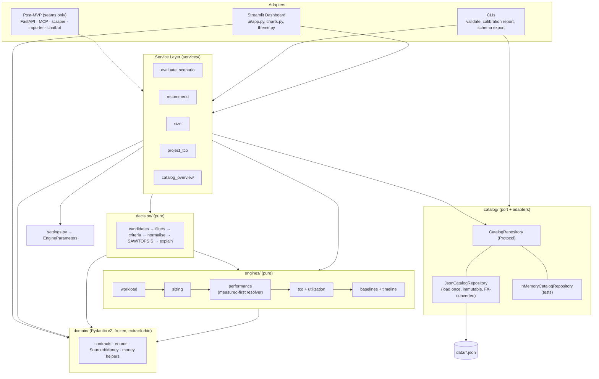
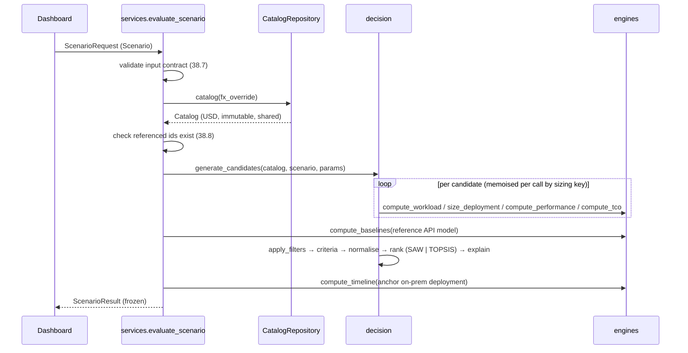

# Design Document: AI TCO DSS MVP

## Overview

The DSS is a Python 3.12 package (`ai_tco_dss`) that turns a scenario (workload, enterprise financials, sizing options, decision options) into three answers: physical fit and speed of a model on hardware, a 60-month TCO against cloud baselines, and a ranked, explained recommendation. The MVP delivery mechanism is a Streamlit + Plotly dashboard. All computation lives in pure, stateless engines behind one service layer, so post-MVP adapters (FastAPI, MCP, scraper, importer) can reuse it unchanged.

Design goals, in priority order:

1. **Traceability.** Every catalog number carries a Provenance_Record. Every computed performance, quality and price value carries a Value_Origin (`measured` or `formula`) with contributing `source_id`s. Measured values beat formulas.
2. **Determinism.** Engines are pure functions of frozen Domain_Contracts. Same inputs give byte-identical results, including ordering.
3. **Simplicity.** One abstraction beyond plain functions: the `CatalogRepository` protocol. No plugin systems, no registries, no generic engine interfaces.
4. **Session continuity.** `progress.md`, the Next Session Prompt, the Project Rules and self-contained tasks let a fresh chat session continue without history.

### Scope

In scope: everything in `requirements.md` (Requirements 1–42). Out of scope (seams only, see [Extension Seams](#extension-seams-post-mvp)): FastAPI, MCP server, multi-user website, benchmark scraper, LiteLLM/PowerBI import, agentic chatbot, database repository, catalog entry form, Views 3–5.

### Research Findings That Shape the Design

| Topic | Finding | Design consequence |
|---|---|---|
| Hetzner GEX63 | Listed at €999.00/month excl. VAT on the [GEX63 product page](https://www.hetzner.com/dedicated-rootserver/gex63/); the Spanish [GPU matrix page](https://www.hetzner.com/es/dedicated-rootserver/matrix-gpu/) shows a one-time setup fee equal to one monthly fee. GPU is the RTX PRO 6000 Blackwell **Max-Q** ([press release](https://www.hetzner.com/pressroom/hetzner-expands-gpu-portfolio-with-new-gex63-featuring-nvidia-rtx-pro-6000-blackwell-max-q/)). | Confirms Req 10.6/10.10 (€999 + €999 setup; spec 02 value €1,197 is outdated or VAT-inclusive). Ledger entry records that the rental GPU is the Max-Q variant while sizing reuses the `rtx-pro-6000-96gb` item (assumption: equal memory, performance treated as equal). |
| Hetzner GEX430 | €3,599.00/month excl. VAT on the [GEX430 page](https://www.hetzner.com/dedicated-rootserver/gex430/), 4× RTX PRO 6000 Blackwell Max-Q, 384 GB VRAM ([Hetzner blog](https://www.hetzner.com/blog/news-vier-gp-us-ein-server-der-gex-430/)). | Rental sized as 4 nodes of `rtx-pro-6000-96gb` (4 ∈ valid node counts {1, 4, 8}). Setup fee verified in Task 4. |
| Hetzner price change | Hetzner adjusted prices for new orders from 15 June 2026 ([price adjustment notice](https://docs.hetzner.com/general/infrastructure-and-availability/price-adjustment/)). | Task 4 must re-fetch prices and record the access date. |
| EUR→USD rate | ECB reference rate shown as EUR 1 = USD 1.1165 on the [ECB USD page](https://www.ecb.europa.eu/stats/policy_and_exchange_rates/euro_reference_exchange_rates/html/eurofxref-graph-usd.ro.html) (early November 2026). | Seed `fx.json` with 1.1165, `source_id = ECB-FX`, tier `official`; Task 4 re-verifies the rate and rate date. Until then the row is also listed in the Assumptions table. |
| Streamlit fragments | Interacting with a widget inside an `@st.fragment` function reruns only that fragment ([st.fragment docs](https://docs.streamlit.io/develop/api-reference/execution-flow/st.fragment), [fragments concept](https://docs.streamlit.io/develop/concepts/architecture/fragments)). Fragments cannot write widgets into outside containers. | Each Simulator_Card is one fragment that owns its widgets and output container (Req 37.5/37.6). |
| Streamlit testing | `st.testing.v1.AppTest` runs an app headless and simulates widget input ([AppTest docs](https://docs.streamlit.io/develop/api-reference/app-testing/st.testing.v1.apptest)). | Dashboard smoke test (Req 6.4) and fragment-isolation test (Req 37.6) use AppTest; render-call counters live in `st.session_state`. |

Content was rephrased for compliance with licensing restrictions.

### Key Design Decisions

| ID | Decision | Rationale | Affects |
|---|---|---|---|
| D-01 | Catalog numbers use a generic `Sourced[T]` wrapper (`value`, `source_id`, `tier`, `accessed`, `note`); money uses `Money` (`Sourced[float]` + `currency`). | One uniform provenance mechanism for JSON, contracts, validator and audit drawer. | 8.3, 8.5, 12.3 |
| D-02 | Provenance coverage rule: a JSON number is covered if it, or any ancestor object, carries `source_id` + `tier` + `accessed`. | Lets Benchmark_Records, `fx.json`, the popularity snapshot and the workload file carry record-level provenance without wrapping each number. | 8.3, 8.5, 14.1 |
| D-03 | Catalog contracts use tuples, never lists or dicts. Lookup indexes are private to the repository. | Frozen Pydantic models still allow mutation of inner lists/dicts; tuples make the shared catalog immutable. | 39.3 |
| D-04 | EUR→USD conversion happens in the repository: `repo.catalog(fx_override)` returns a converted, cached Catalog. The default-rate Catalog is one process-wide instance. | Engines never see EUR (12.3, 22.14); an Expert-mode FX override needs a re-converted catalog without touching `fx.json` (12.4). | 12.3, 12.4, 39.2 |
| D-05 | Engine tunables (η, γ, δ_ctx, tolerance, batching, risk weights …) live in `settings.py`, loaded with pydantic-settings into an `EngineParameters` Domain_Contract that engines receive as an argument. | Engines may depend only on Domain_Contract arguments (38.2); settings stay overridable via env vars `AI_TCO_*`. | 7.1, 9.5, 9.10, 20.6 |
| D-06 | Quality scores are Benchmark_Records (`aa_index_v5`, `terminal_bench`, `swe_bench`) in `data/benchmarks/quality.json`, not model fields. | One measured-first path for performance and quality (9.9). | 9.9, 10.8 |
| D-07 | Utilization capacity fallback uses the physical stream limit `U_max` (bounded by a per-node batch cap), not the workload's `peak_concurrent_requests`. | Utilization must express idle capacity; tying capacity to demand concurrency would make large servers look saturated. | 23.4 |
| D-08 | Requirement 20.1 is applied literally for multi-node: single-stream decode uses per-node bandwidth × α_scaling (no × N). Aggregate capacity scales with N (23.1). | Follows the approved requirement; conservative for tensor parallelism. The calibration report quantifies the error on multi-node records; a large error triggers a ledger entry and a requirement change proposal. | 20.1, 23.1, 42 |
| D-09 | The 60-month timeline (View 2, KPI break-even) is always anchored on an on-premise deployment: the rank-1 candidate if it is on-premise, otherwise the hybrid local deployment of Req 27.4. | Requirement 26 defines break-even of on-premise against baselines; API or rental rank-1 candidates appear as one of the compared series. | 26, 34.2, 35.4 |
| D-10 | Romania employer social tax = **2.25 %** (statutory CAM). The ~4 % figure includes private clinic and meal benefits, which are not a social tax. | The field is "employer social tax rate"; the statutory value is sourced to an official authority, benefits would be an assumption. | 13.6 |
| D-11 | The CSV export button downloads one ZIP archive containing exactly the two CSV files of Req 36.5. | Streamlit's `st.download_button` delivers one file per click. Recorded as a known deviation in the ledger (entry C-012). | 36.5 |
| D-12 | One verification helper `scripts/verify.py` runs focus tests, then `ruff check`, `ruff format --check`, `mypy`, the Validate_CLI (once it exists) and the full `pytest` suite. | Req 4.3 requires one command line per task that works in both PowerShell 5.1 (no `&&`) and bash. | 4.3, 41.2 |

## Architecture

### Layers (ports and adapters)



Dependency rules (enforced by tests):

- `engines/` and `decision/` import only `domain/` (and the standard library). No file, network or module-level mutable state (Req 38.2).
- `services/` imports `domain/`, `engines/`, `decision/`, `catalog/` (protocol and default repository factory) and `settings`.
- `ui/` imports only `ai_tco_dss.services`, `ai_tco_dss.domain`, `ai_tco_dss.ui` (Req 37.7, 37.8, 38.6).
- `catalog/` imports `domain/`; it is the only package that reads `data/`.

### Request flow: `recommend` / `evaluate_scenario`



### Module and File Layout

```
pyproject.toml, uv.lock, README.md, progress.md, CLAUDE.md, LICENSE
.github/workflows/ci.yml
.kiro/steering/project-rules.md
scripts/verify.py                         # one-line task verification (D-12)
schemas/                                  # generated JSON Schemas (Req 7.8)
reports/                                  # calibration CSV output (gitignored except .gitkeep)
specs/00 … 06 (existing), 07_DATA_CORRECTIONS.md
data/
  sources.json
  catalog/README.md
  catalog/hardware/<id>.json              # one file per hardware item
  catalog/models/<id>.json                # one file per model item
  benchmarks/<topic>.json                 # {"records": [...]}, e.g. decode.json, prefill.json, aggregate.json, quality.json
  reference/fx.json, electricity.json, staffing_hubs.json, harnesses.json, use_cases.json, rentals.json,
            presets.json, popularity.json, baselines.json
  workloads/default.json
src/ai_tco_dss/
  __init__.py
  settings.py                             # defaults + env loading → EngineParameters; ConfigurationError on bad values
  domain/
    __init__.py                           # re-exports public contracts
    base.py                               # Contract base config, Sourced[T], Money, SourceTier, ValueOrigin, Metric, FormulaTrace
    enums.py                              # enums from spec 04 (+ Metric names, CandidateKind, UseCaseId, PresetId, RankingMethod)
    catalog.py                            # SourceEntry, HardwareSpec, ModelSpec, RentalSpec, BenchmarkRecord, reference contracts, Catalog
    scenario.py                           # WorkloadProfile, EnterpriseFinancials, SizingOptions, DecisionOptions, Scenario, EngineParameters
    results.py                            # WorkloadResult, SizingResult, PerformanceResult, TcoResult, BaselineResult, TimelineResult, …
    inputs.py                             # one *Input contract per public engine/decision function
    requests.py                           # SizeRequest, TcoRequest, RecommendRequest, ScenarioRequest + result wrappers
    money.py                              # usd_to_eur, eur_to_usd, round_display (pure)
    errors.py                             # DssError hierarchy
    export_schemas.py                     # schema export CLI (Req 7.8–7.10, 40.2)
  catalog/
    __init__.py
    repository.py                         # CatalogRepository Protocol
    json_repository.py                    # JsonCatalogRepository, get_default_repository()
    memory_repository.py                  # InMemoryCatalogRepository
    loading.py                            # raw JSON read, provenance walker, contract validation, cross-reference checks
    fx.py                                 # convert_catalog(catalog, rate) → USD catalog
    validate.py                           # Validate_CLI entry point (uses loading.py, collects all errors)
  engines/
    __init__.py
    workload.py                           # compute_workload
    sizing.py                             # size_deployment
    resolver.py                           # select_benchmark (measured-first rules of Req 9)
    performance.py                        # compute_performance, compute_api_performance
    tco.py                                # compute_tco (CapEx, OpEx, utilization, resale)
    baselines.py                          # compute_baselines, compute_rental_cost, compute_hybrid_cost, compute_timeline
  decision/
    __init__.py
    quality.py                            # resolve_quality, aa_scaling_ratio
    candidates.py                         # generate_candidates, evaluate_candidate
    filters.py                            # apply_hard_filters
    ranking.py                            # criteria, normalise, rank_saw, rank_topsis, explain
  services/
    __init__.py                           # evaluate_scenario, recommend, size, project_tco, catalog_overview
    scenario_service.py                   # orchestration
    calibration_report.py                 # Calibration_Report CLI (adapter: reads repo, writes CSV)
  ui/
    __init__.py
    app.py                                # Streamlit entry point
    state.py                              # session_state keys, input validators (users, FX override)
    sidebar.py                            # Normal/Expert inputs
    kpi.py                                # KPI ribbon
    cards.py                              # Simulator_Cards (@st.fragment) for View 1 and View 2
    ranking_tab.py                        # ranking table, rejected list, TOPSIS comparison
    audit.py                              # audit drawer, JSON/CSV export
    charts.py                             # pure Plotly figure factories
    theme.py                              # Okabe-Ito constants, archetype styles
    formatting.py                         # display currency formatting, DataFrame builders
tests/
  conftest.py                             # offline guard (socket blocked), fixtures: repo, in-memory repo, default scenario
  unit/ property/ calibration/ integration/
```

### Concurrency Model

- **One catalog per process.** `get_default_repository()` builds the `JsonCatalogRepository` under a `threading.Lock` with double-checked initialisation, so the files are read exactly once (39.1). The Streamlit app wraps it with `@st.cache_resource`, which returns the same object (39.2).
- **Immutable shared data.** Catalog contracts are frozen with tuple-only collections (D-03). Attempted assignment raises `ValidationError`; tuples have no mutators (39.3).
- **FX-override catalogs.** `repo.catalog(rate)` caches converted catalogs in a small dict (max 8 entries) guarded by the same lock. The default rate returns the canonical instance.
- **Stateless computation.** Engines and decision code hold no module-level mutable state. Per-call memoisation (e.g. sizing results shared by on-prem and rental candidates for the same `(hardware, nodes, model, precision)`) lives in a local `dict` inside `evaluate_scenario`.
- **Streamlit sessions** run in separate script threads. Each session keeps only its own `st.session_state`. `evaluate_scenario` results are cached with `@st.cache_data(max_entries=64)` keyed by the scenario JSON, which is safe because results are deterministic.
- **Performance budget.** The MVP catalog yields about 13 hardware×node combinations × 8 open models × ~3–4 precisions ≈ 400 on-prem candidates, plus 16 rental, 4 API and up to 4 hybrid candidates. Each candidate costs a handful of arithmetic steps and ~6 contract constructions. Timelines (60 points) are built only for the anchor deployment and on demand through `project_tco`; per-candidate break-even uses closed-form arithmetic on plain floats. Expected `recommend` time is well below the 500 ms median budget (39.7); the integration test enforces it.

## Components and Interfaces

### Domain base (`domain/base.py`)

```python
class Contract(BaseModel):
    model_config = ConfigDict(frozen=True, extra="forbid", allow_inf_nan=False,
                              validate_default=True, use_enum_values=False)

class SourceTier(StrEnum):
    OFFICIAL = "official"; THIRD_PARTY = "third_party"; COMMUNITY = "community"
    FORMULA = "formula"; ASSUMPTION = "assumption"

TIER_RANK = {OFFICIAL: 4, THIRD_PARTY: 3, COMMUNITY: 2, ASSUMPTION: 1, FORMULA: 0}

class Sourced[T](Contract):                     # PEP 695 generic, Pydantic v2 generic model
    value: T
    source_id: str = Field(min_length=1)
    tier: SourceTier
    accessed: date                              # ISO 8601 YYYY-MM-DD
    note: str | None = None                     # e.g. "single-source"

class Money(Sourced[float]):
    currency: Literal["EUR", "USD"]
    value: float = Field(ge=0)
    fx_source_id: str | None = None             # set when converted EUR→USD
    original_value: float | None = None         # EUR amount before conversion

class ValueOrigin(Contract):
    origin: Literal["measured", "formula"]
    source_ids: tuple[str, ...] = Field(min_length=1)

class Metric(Contract):                         # a computed number with its origin
    value: float
    unit: str
    origin: ValueOrigin

class FormulaTrace(Contract):                   # for the audit drawer (Req 36.1)
    name: str                                   # e.g. "decode_tps"
    symbolic: str                               # "BW ÷ M_active × η × γ × δ_ctx × α"
    substituted: str                            # "1800 GB/s ÷ 14.18 GB × 0.70 × 1.0 × 0.62 × 1.0"
    result: float
    unit: str
```

### Settings (`settings.py`)

`settings.py` defines `Settings(BaseSettings)` (env prefix `AI_TCO_`) holding the defaults below and a function `load_engine_parameters() -> EngineParameters`. If a value is out of range, it raises `ConfigurationError(setting, value)` (Req 9.10). All values marked *assumption* appear in the ledger's Assumptions table.

| Parameter | Default | Label | Req |
|---|---|---|---|
| `context_match_tolerance` | 0.25 (range [0, 1]) | assumption | 9.5, 9.10 |
| `eta_dense`, `eta_moe` | 0.70, 0.425 | assumption | 20.2 |
| `gamma_spec` | none 1.0, apple-mtp-dflash 1.425, built-in-mtp 1.80, external-draft 2.75 | assumption | 20.3 |
| `delta_ctx_breakpoints` | (8 192, 1.00), (32 768, 0.89), (131 072, 0.60), (262 144, 0.50), (1 048 576, 0.40); linear interpolation in log2(context); 1.0 below 8 192; constant 0.40 above 1 048 576 | assumption | 20.6 |
| `alpha_scaling` | NVLink 0.90, PCIe-Gen5 0.75, DGX-Ring-Cable 0.72, Thunderbolt-5-RDMA 0.65 (requirement values); RoCE-200Gbps 0.80, PCIe-Gen4 0.70, PCIe-Gen3 0.60, WiFi-7-Virtual-GPU 0.30, Unified-Single 1.00 (assumption) | mixed | 18.4 |
| `weight_overhead_factor` | 1.05 | formula constant (spec 01) | 17.2, 20.1 |
| `mla_kv_bytes_per_token` | 890 | formula constant (spec 01, YT-05) | 17.3 |
| `phi_format` | gguf 1.0, vllm 1.0, mlx 1.08 | formula constant | 17.4 |
| `mcp_prune_ratio` | 0.75 | spec 01 | 15.1 |
| `thinking_multipliers` | none 1.0, low 1.5, medium 2.5, extra-high 4.94 | spec 01 | 15.3 |
| `claude_tokenizer_inflation` | 1.30 | spec 01 | 15.2 |
| `mega_session_slope` | 2.8 | spec 01 | 15.5 |
| `batch_streams_cap_per_node` | 64 | assumption | 23.4 |
| `batching_contention` (c) | 0.03 | assumption | 23.4 |
| `hours_per_month` | 730 | formula constant | 22.3 |
| `utilization_threshold`, `idle_warning_threshold` | 0.70, 0.55 | spec 02 | 23.5, 23.6 |
| `risk_weight_support`, `risk_weight_fidelity` | 0.5, 0.5 | assumption | 29.4 |
| `risk_support_years_cap` | 5.0 | assumption | 29.4 |
| `risk_rental_lifecycle`, `risk_api_lockin` | 0.20, 0.40 | assumption | 29.4 |
| `risk_missing_agreement` | 0.95 | assumption | 29.4 |
| `aa_ratio_default` | 2.0 | assumption | 31.4 |
| `calibration_tolerance_pct` | decode_tps 30, prefill_tps 50 | assumption | 42.2 |
| `eviction_events_per_month` | 30 | assumption (YT benchmark, spec 01 §1.3) | 22.8 |
| `eviction_compute_price_per_1m_usd` | 0.30 | assumption | 22.8 |

### Engine call convention

Every public engine and decision function takes exactly one `*Input` Domain_Contract (defined in `domain/inputs.py`) plus `params: EngineParameters`, and returns one result contract. This satisfies Req 7.1 literally. Pydantic v2 does not revalidate nested model instances by default (`revalidate_instances="never"`), so building an input contract from existing contracts is cheap. Benchmark records reach engines as `BenchmarkSet(records: tuple[BenchmarkRecord, ...])`, pre-filtered for the `(model_id, hardware_id)` pair by a per-call index that the decision code builds from `Catalog.benchmarks` (a local `dict`, discarded after the call).

### Catalog port (`catalog/repository.py`)

```python
class CatalogRepository(Protocol):
    def catalog(self, fx_override: float | None = None) -> Catalog: ...
    def load_workload(self, path: Path | None = None) -> WorkloadProfile: ...   # None → data/workloads/default.json
```

- `JsonCatalogRepository(root: Path)` loads `data/` through `catalog/loading.py` (same checks as the Validate_CLI). Any error raises `CatalogLoadError` listing every error with file path and field path; no partial Catalog is returned (Req 11.10). Files without the `.json` extension are ignored (11.2). It then converts EUR money to USD (`catalog/fx.py`).
- `InMemoryCatalogRepository(catalog: Catalog)` holds an already-built Catalog (used by tests, and later by a DB repository or the scraper).
- `get_default_repository() -> JsonCatalogRepository` returns the process-wide instance (lock-guarded, Req 39.1).

`load_workload(path)` raises `WorkloadFileError(path, fields)` if the file is missing, is not JSON, or fails `WorkloadFile` validation (Req 14.7).

### Validate_CLI (`catalog/validate.py`)

Command: `uv run ai-tco-validate` (console script → `ai_tco_dss.catalog.validate:main`). It runs all checks, collects every error, and never stops at the first one (8.10, 11.3).

Check order (each check runs over all files):

1. **Parse**: `json.loads` per file; `JSONDecodeError` → error with `lineno:colno` (11.4).
2. **Provenance coverage** (D-02): walk raw JSON; every number not covered → error `file: field_path: numeric value lacks Provenance_Record` (8.5).
3. **Contract validation**: validate with `HardwareSpec`, `ModelSpec`, `BenchmarkFile`, reference contracts, `SourcesFile`, `WorkloadFile`. Pydantic `loc` becomes the field path (11.3, 13.8).
4. **Filename = id** (11.8); **duplicate ids** across both catalog folders (11.5); **duplicate `source_id`** in `sources.json` (8.8).
5. **Provenance rules** on every `Sourced`/record: `source_id` exists (8.4, 11.6); `tier` is one of five values; `accessed` ≤ today; YT-01..YT-22 must have tier `community` (8.9); a single-source YT value must carry `note = "single-source"` (8.7); provenance tier must equal the registry tier of that `source_id`.
6. **Benchmark rules**: `model_id` / `hardware_id` resolve (11.6); `context_tokens ≥ 1` for `prefill_tps`, `decode_tps`, `aggregate_tps`, `ttft_s` (9.8).
7. **MVP completeness** (10.11): the required ids of Req 10.1/10.3/10.4/10.6 exist; required prices, parameter counts and quality scores are present.
8. **Reference rules** (13.8, 32.8): required tariffs/hubs/harnesses/use cases/rentals exist with bounds; presets have six weights in [0, 1] summing to 1 ± 1e-6 and satisfy the dominance rules of 32.2–32.5; popularity values ≥ 0 and unique `model_id`s.

Output: one line per error `path: field_path: message`, then `N errors`, exit code 1. On success: `Validated H hardware, M model, B benchmark, R reference files: 0 errors`, exit code 0 (11.9).

### Workload_Engine (`engines/workload.py`)

```python
class WorkloadInput(Contract): profile: WorkloadProfile; model: ModelSpec; harnesses: tuple[HarnessEntry, ...]
def compute_workload(inp: WorkloadInput, params: EngineParameters) -> WorkloadResult
```

Formulas (Req 14.4, 15.1–15.7):

```
monthly_requests = active_users × daily_requests_per_user × working_days_per_month
S_harness       = profile.custom_scaffolding_tokens if harness == custom-lean and set, else harnesses[harness]
S_effective     = S_harness × (1 − r_mcp_prune)              r_mcp_prune = 0.75 if mcp_code_mode_pruning else 0.0
τ               = 1.30 if model.family == "Claude" else 1.00
T̂_in            = (T_in + S_effective) × τ
T̂_out           = T_out × τ
out_think       = T̂_out × μ_thinking
κ_mega          = 1 + mega_session_ratio × 2.8
ν_verify        = 2.0 if has_verification_agent_layer else 1.0
monthly_tokens  = monthly_requests × (T̂_in + out_think) × κ_mega × ν_verify
monthly_output_demand = monthly_requests × out_think × ν_verify          (Utilization numerator, Req 23.1)
```

Reference values for the Default_Workload_File (25 users, 40 req/day, 22 days, 15 000 in, 1 500 out, claude-code, no pruning, medium thinking, mega ratio 0.35, no verifier):
`monthly_requests = 22 000`, `κ_mega = 1.98`; non-Claude model: `T̂_in = 48 000`, `out_think = 3 750`, `monthly_tokens = 2 254 230 000`, `monthly_output_demand = 82 500 000`; Claude model: `T̂_in = 62 400`, `out_think = 4 875`, `monthly_tokens = 2 930 499 000`.

### Sizing_Engine (`engines/sizing.py`)

```python
class SizingInput(Contract):
    hardware: HardwareSpec; model: ModelSpec; precision: PrecisionFormat
    requested_nodes: float          # float so that non-integers reach the engine check of Req 18.7
    options: SizingOptions; profile: WorkloadProfile
    license_alternatives: tuple[str, ...]   # Apache-2.0/MIT model names for the Req 19.2 warning
def size_deployment(inp: SizingInput, params: EngineParameters) -> SizingResult
```

Algorithm (Req 16–19):

1. **Node count** (18.1, 18.2, 18.7, 18.8): reject non-integer or outside [1, 8] with `EngineInputError`. Snap 3→4, 5/6/7→8 with a warning. If the effective count is not in `hardware.valid_node_counts`, mark infeasible with reason.
2. **Usable memory per node** (16.1–16.4, 16.8, 16.9) by `hardware.memory_architecture`:
   - `apple-unified`: `adv × (1 − os_reserved_memory_ratio)`; with `apply_mac_wired_memory_override` and `tuned_max_usable_memory_gb` present → tuned value; if missing → default value plus warning.
   - `amd-unified`: default formula; with `linux_amd_override` → `linux_max_usable_memory_gb` (or default plus warning if missing).
   - `discrete`: `adv × gpu_memory_utilization` (default 0.90).
   - Bounds validated first (ratio ∈ [0, 1), utilization ∈ (0, 1], overrides ∈ (0, adv]); violation → `EngineInputError(field, hardware_id)`.
   - Rounded to 0.01 GB for reporting; full precision used internally.
3. **Aggregate usable memory** = N × per-node usable (18.3). For `tiered-offload-appliance`, weight capacity = usable VRAM + `system_ram_offload_gb` (18.6), and exactly one Strata 8 192-token warning (18.9).
4. **Weights** (17.1, 17.2): calibrated footprint for the precision → `Metric(origin=measured)`; else `P_total × bits/8 × 1.05` → `formula`. Bits: FP16/BF16 16, FP8/INT8 8, INT4 4, INT3 3, INT2 2.
5. **KV per token** (17.3, 17.4, 17.12): MLA → 890 bytes; otherwise `2 × n_layers × r_kv_active × n_kv_heads × d_head × kv_bits/8 × φ_format`, with `r_kv_active = 1.0` for `standard-mha-gqa`. `φ_format`: `options.runtime_format`, where `auto` resolves to `mlx` for Apple hardware and `vllm` otherwise. Missing or non-positive parameters → `EngineInputError(model_id, params)`.
6. **KV pool and U_max** (17.5, 17.6): `M_kv_single = kv_per_token × target_context / 1e9`; `pool = usable_total − weights − runtime_overhead_gb`; for tiered-offload, the weight part that exceeds VRAM is placed on the Shelf and only `min(weights, usable_vram)` is subtracted from the VRAM pool. `U_max = floor(pool / M_kv_single)`. If `pool ≤ 0` or `U_max < 1`: infeasible, `U_max = 0`, and `oom_reason` names the shortfall in GB (1 decimal).
7. **Total required memory** for the Mac trap (16.5) = `weights + runtime_overhead + M_kv_single`. The trap flag is true iff `default_usable < required ≤ tuned_max` (independent of the override). The warning contains `sudo sysctl iogpu.wired_limit_mb=<floor(tuned_max × 1024)>` (16.7).
8. **Agent state and eviction** (17.7, 17.11): `agent_state = N_agents × (M_kv_single + repo_workspace_gb)`. Usable system RAM = per-node usable memory for unified architectures, else `system_ram_total_installed_gb × N`. `context_eviction_risk = agent_state > usable_system_ram`.
9. **Breakdown** (17.8): `weights`, `kv_cache_active = M_kv_single × min(peak_concurrent_requests, U_max)`, `agent_state_parked`, `os_reserved = advertised_total − usable_total`, `runtime_overhead`.
10. **Flags** (19.1–19.7): `max_usable_context = min(model.max_context, floor(pool_bytes / kv_per_token))` (0 if pool ≤ 0); `meets_128k_agentic_context_floor`; `eu_commercial_license_valid = license != Llama-4-EU-Ban` with warning listing ≥ 1 Apache-2.0/MIT alternative; `token_agreement_rate` lookup; schema-break warning if < 0.90.
11. **α_scaling** (18.4) and `thunderbolt_mesh_cables = N(N−1)/2` for TB5 RDMA (18.5).

Reference case (16.6): Qwen 3.8 Flash Next INT4 (111 GB calibrated) on Mac Studio M5 Max 128 GB, `target_context_length = 8 192`. Default usable 128 × (1 − 0.195) = 103.04 GB → infeasible. Override 115 GB → feasible. Trap flag true in both. The test uses a short context so that the KV term cannot dominate. If the catalog's KV parameters make the override case infeasible, the deviation goes into the ledger.

### Measured-first resolver (`engines/resolver.py`)

```python
class BenchmarkQuery(Contract):
    records: BenchmarkSet; metric: BenchmarkMetric; model_id: str; hardware_id: str | None
    precision: PrecisionFormat | None; target_context: int | None; tolerance: float
def select_benchmark(query: BenchmarkQuery) -> BenchmarkRecord | None
```

```
candidates = [r for r in records
              if r.metric == metric and r.model_id == model_id
              and r.hardware_id == hardware_id and r.precision == precision
              and (target_context is None or |r.context_tokens − target_context| ≤ tolerance × target_context)]
if not candidates: return None
sort key (ascending) = (−TIER_RANK[r.tier], −r.accessed.toordinal(),
                        |r.context_tokens − target_context| if target_context else 0,
                        r.source_id)
return candidates sorted by key [0]
```

- Quality metrics (`aa_index_v5`, `terminal_bench`, `swe_bench`) call with `hardware_id=None`, `precision=None`, `target_context=None` (9.9).
- `tolerance ∉ [0, 1]` → `ConfigurationError` (9.10). This is checked when `EngineParameters` is built and again in the resolver as a guard.
- The per-call index keeps each `BenchmarkSet` small, so the linear filter is cheap.

### Performance_Engine (`engines/performance.py`)

```python
class PerformanceInput(Contract):
    hardware: HardwareSpec; model: ModelSpec; precision: PrecisionFormat; sizing: SizingResult
    workload: WorkloadResult; profile: WorkloadProfile; options: SizingOptions
    benchmarks: BenchmarkSet; use_measured: bool = True
class ApiPerformanceInput(Contract): model: ModelSpec; workload: WorkloadResult; profile: WorkloadProfile

def compute_performance(inp: PerformanceInput, params: EngineParameters) -> PerformanceResult
def compute_api_performance(inp: ApiPerformanceInput, params: EngineParameters) -> PerformanceResult
```

- **Decode** (20.1–20.7): measured `decode_tps` record if matched; else `BW_node / (P_active × bits/8 × 1.05) × η × γ × δ_ctx(target) × α`. `η` comes from architecture (dense 0.70, MoE 0.425). Invalid inputs → `EngineInputError`.
- **Prefill** (21.1): measured `prefill_tps` at the target context; else `hardware.base_prefill_tps_at_32k` (`formula` origin with its source_id); if neither exists → TTFT, effective TPS and 1M prefill are "not available" (`None`) plus a warning (21.7).
- **TTFT** (21.2, 21.3, 21.9): `T̂_in(1 − r_cache) / (prefill × β)` with `β = 1.0 | 0.035`, plus `target_context / (prefill × β)` when `context_eviction_risk`. If `r_cache ∉ [0, 1]` → `EngineInputError`.
- **Effective TPS** (21.4, 21.8): `out_think / (TTFT + out_think / decode)`, where `out_think = T_out × μ_thinking` (no τ here, per Req 21.4); 0 if `out_think = 0`.
- **1M prefill minutes** (21.5): measured record at 1 000 000 tokens → `hardware.prefill_tps_at_1m` → `prefill_tps` plus overestimation warning.
- **API candidates**: `decode = model.api_decode_tps`, `TTFT = model.api_ttft_s` (catalog `Sourced`, typically third_party), effective TPS with the same formula; missing values → `None` (the Criterion becomes "missing", Req 29.12).
- Every value is a `Metric` with Value_Origin plus a `FormulaTrace` (Req 9.7, 36.1).
- `use_measured=False` disables the resolver; the calibration tests use this path (42.1).

### TCO_Engine (`engines/tco.py`)

```python
class TcoInput(Contract):
    hardware: HardwareSpec; nodes: int; sizing: SizingResult; performance: PerformanceResult
    workload: WorkloadResult; profile: WorkloadProfile; financials: EnterpriseFinancials
    tariffs: tuple[ElectricityTariff, ...]; hubs: tuple[StaffingHub, ...]   # engine selects; missing id → error (22.12)
    benchmarks: BenchmarkSet; demand_share: float = Field(1.0, ge=0, le=1)
    cloud_ttft_s: float | None = None
def compute_tco(inp: TcoInput, params: EngineParameters) -> TcoResult
```

- `units = nodes`, or `active_users` for `per-seat-workstation` (22.1, 22.2). `gpu_count = units × hardware.gpus_per_unit`.
- `CapEx = units × street_price × hardware.datacenter_multiplier + cabling_kit[nodes]` (μ ∈ [1.0, 2.5]).
- `energy = units × (H_a × W_load + (730 − H_a) × W_idle) / 1000 × PUE × rate`, where `H_a = profile.active_hours_per_month`.
- `personnel = FTE × hub.base_salary × (1 + hub.employer_social_tax_pct / 100) / 12`; `munich_vs_romania = personnel(munich) − personnel(romania)` with the same FTE (22.10).
- `nim = license_per_gpu_yr / 12 × gpu_count` if enabled, else 0.
- `opportunity = CapEx × capital_opportunity_rate / 12`.
- `wait_penalty = max(0, H_local − H_cloud) × dev_rate` if enabled, else 0, where `H_local = monthly_requests × TTFT_local / 3600` and `H_cloud = monthly_requests × cloud_ttft_s / 3600` (0 if unknown).
- `eviction_loss` (22.8, spec 02 §2.4) if `context_eviction_risk`, else 0:
  `N_ev × (rebuild_tokens / 1e6 × P_compute + wait_h × dev_rate / N_agents)`, where `N_ev = eviction_events_per_month` (assumption), `rebuild_tokens = target_context`, `P_compute = eviction_compute_price_per_1m_usd` (assumption), `wait_h = target_context / (prefill × β) / 3600`.
- `resale(m) = CapEx × max(0, 1 − (1 − r_resale_3yr) × m / 36)` for m ∈ [0, 60] (22.9).
- `monthly_opex = energy + personnel + nim + opportunity + wait_penalty + eviction_loss`; all components are reported even when 0 (22.13).
- **Utilization** (23.1–23.8):
  - `demand = workload.monthly_output_demand × demand_share` (`demand_share = 1` for on-prem and rental, `local_offload_ratio` for the hybrid local part).
  - Aggregate throughput: a measured `aggregate_tps` record within tolerance → `measured`; else the **formula fallback**:
    ```
    n          = min(U_max, batch_streams_cap_per_node × nodes)          # concurrent streams the memory holds
    E(n)       = 1 / (1 + c × (n − 1))                                    # saturating batching efficiency, c = 0.03
    raw        = decode_single × n × E(n)
    cap        = nodes × base_prefill_tps_at_32k                          # compute bound: batched decode ≤ prefill rate
    per_unit   = min(raw, cap)
    aggregate  = units_factor × per_unit                                  # units_factor = units for per-seat, else 1
    capacity   = aggregate × 3600 × active_hours_per_month
    ```
    The curve saturates at `1/c ≈ 33×` single-stream speed. Origin is `formula` with the decode, prefill and memory source_ids.
  - `utilization = demand / capacity`, unrounded and uncapped. If infeasible or capacity = 0 → `None`, threshold false, capacity-insufficient, warning.
  - `meets_70_percent_utilization_threshold = utilization ≥ 0.70`; idle warning if < 0.55; capacity-insufficient plus shortfall warning if > 1.0.
- Any monetary input with `currency != "USD"` → `EngineInputError` (22.14). Out-of-range inputs → `EngineInputError(field)` (22.12).

### Baseline_Engine (`engines/baselines.py`)

```python
def api_monthly_cost(inp: ApiCostInput, params: EngineParameters) -> ApiCost            # B or C for one model
def compute_baselines(inp: BaselineInput, params: EngineParameters) -> BaselineResult    # A, B, C, delta
def compute_baseline_d(inp: BaselineDInput, params: EngineParameters) -> BaselineD
def compute_rental_cost(inp: RentalCostInput, params: EngineParameters) -> RentalCost
def compute_hybrid_cost(inp: HybridCostInput, params: EngineParameters) -> HybridCost
def compute_timeline(inp: TimelineInput, params: EngineParameters) -> TimelineResult
```

Input contracts carry the obvious fields: `ApiCostInput(workload, profile, prices, eu_pinned, gateway_fee_usd)`, `BaselineInput(workload_ref, profile, ref_model, plan, gateway_fee_usd, financials)`, `BaselineDInput(performance, utilization, profile, model, infeasible_reason)`, `RentalCostInput(rental, personnel_monthly_usd)`, `HybridCostInput(local: TcoResult, api_c_monthly_usd, local_offload_ratio: float)` (no contract bound on the ratio, so the engine raises the Req 25.6 error itself), `TimelineInput(onprem, include_resale, baselines, baseline_d, rental, hybrid, decode_tps, open_output_price)`.

- **Baseline A** (24.1–24.3): `active_users × plan.price_per_seat_month`. Eligibility reasons: "no EU data residency or enterprise DPA" (strict sovereignty) and "third-party harnesses blocked on consumer plans" (third-party harness required). The cost is always returned.
- **Baseline B** (24.4), per request using the reference model's prices (USD per 1e6 tokens):
  ```
  per_req = [T̂_in(1 − r_cache)P_in + T̂_in r_cache P_cache + out_think P_out] / 1e6
  B = monthly_requests × per_req × κ_mega × ν_verify × (1 − 0.5 r_batch)
  ```
  Hand-computed reference (Default_Workload_File, Claude Sonnet 5.5 with spec 03 prices $2 / $0.10 / $10, r_cache 0.5, r_batch 0.2): `per_req = 0.0624 + 0.00312 + 0.04875 = 0.11427`; `B = 22 000 × 0.11427 × 1.98 × 1 × 0.9 = 4 479.84108 USD`. With gateway fee 500 USD: `C = 5 427.825 USD`; `A = 25 × 200 = 5 000 USD`; compliance tax delta `= 427.825 USD`. Task 4 replaces the spec 03 prices with verified ones; the unit test computes its expected value from the same inputs.
- **Baseline C** (24.5): `B × 1.10 + gateway_fee` (default gateway fee 500 USD/month, assumption, `baselines.json`).
- **Baseline D** (24.6): `H_a × 3600 × effective_tps × min(U, 1) / 1e6 × P_open_out`. Unavailable (with reason) if the candidate is infeasible or the open-weights price is missing.
- **Compliance tax delta** (24.7) = `C − A`, independent of eligibility.
- **Rental** (25.1): `cum(m) = setup + m × (monthly + personnel)`.
- **Hybrid** (25.2–25.5): `monthly = local.monthly_opex + (1 − r) × C_api`; `cum(m) = local.capex + m × monthly`. `r ∉ [0, 1]` → `EngineInputError("local_offload_ratio", "[0.0, 1.0]")`.
- **Timeline** (26.1–26.9): 60 points, `onprem(m) = CapEx + m × monthly_opex − (resale(m) if include_resale)`. Series A, B, C are `m × monthly`, D is `m × D` (or `None`). Break-even per series = smallest m with `onprem(m) ≤ series(m)` (unrounded), else `None`. Single-stream break-even years = `CapEx / (decode × 3600 × 8760 × P_out / 1e6)`, or `None` if decode or price is missing or 0.
- All values are in USD with Value_Origin `formula` and the price/reference source_ids (24.11).

### Decision pipeline (`decision/`)

```python
def generate_candidates(inp: CandidateInput, params: EngineParameters) -> CandidateSet      # (catalog, scenario)
def apply_hard_filters(inp: FilterInput, params: EngineParameters) -> FilteredCandidates     # (candidates, scenario, use_case, ratios)
def rank(inp: RankingInput, params: EngineParameters) -> RankingResult                       # (feasible, weights, method)
```

**1. Candidate generation** (27.1–27.8):

| Kind | Enumeration | Id format | Cost basis |
|---|---|---|---|
| `onprem` | hardware × node count (∈ {1,2,4,8} ∩ valid) × open model × precision (calibrated ∪ native, deduplicated) | `onprem:{hw}:{n}x:{model}:{precision}` | TCO_Engine; 60-month TCO = `onprem(60)` |
| `api` | each commercial model (strict: EU-pinned priced by C; non-pinned priced global and later rejected) | `api:{model}` | `60 × monthly` |
| `rental` | each EU_Rental × open model (16 for MVP) | `rental:{rental}:{model}` | `setup + 60 × (monthly + personnel)` |
| `hybrid` | each commercial model, combined with the selected local deployment | `hybrid:{onprem_id}+{api_model}` | `capex + 60 × hybrid_monthly` |

- **Rental sizing** uses the rental's GPU hardware item (`rtx-pro-6000-96gb`) with `nodes = gpu_count` and `system_ram_total_installed_gb` taken from the rental. The precision is the highest-bit precision of the model (calibrated ∪ native) that is feasible; if none is feasible, the smallest-footprint precision is used so that the memory-fit filter records the rejection.
- **Hybrid local selection** (27.4): the feasible on-prem candidate with the lowest 60-month TCO; ties broken by `(hardware_id, nodes, model_id, precision)`. If none is feasible → zero hybrids plus a warning (27.8).
- **Ordering** (27.5): kind order `onprem, api, rental, hybrid`, then ascending tuple keys `(hardware_id, nodes, model_id, precision.value)`, `(model_id,)`, `(rental_id, model_id)`, `(local_id, api_model_id)`.
- **Memoisation**: sizing and performance per `(hardware_id, nodes, model_id, precision)` are cached in a local dict for the call, so rental candidates reuse on-prem results.

**2. Hard filters** (28.1–28.8). All nine are evaluated for every candidate. Each failure records `FilterFailure(name, measured, threshold)`.

| Filter | Pass condition | Not applicable (auto-pass) |
|---|---|---|
| `memory_fit` | `sizing.is_feasible` | api |
| `eu_license` | `eu_commercial_license_valid` | api |
| `eu_sovereignty` | strict ⇒ api model / hybrid API part has an EU-pinned endpoint ("no EU-pinned endpoint") | onprem, rental |
| `min_tps` | `effective_tps ≥ min_acceptable_tps` (skipped if unset) | — |
| `max_ttft` | `ttft ≤ max_acceptable_ttft_seconds` (skipped if unset) | — |
| `users_served` | `utilization` defined and `≤ 1.0` | api |
| `context_128k` | `meets_128k_agentic_context_floor`; api: `max_context ≥ 128 000` | — |
| `quality_floor` | resolved quality ≥ Quality_Floor (missing → fail, measured "not available") | — |
| `capex_budget` | `capex ≤ max_capex_budget_usd` (skipped if unset) | api, rental |

Missing TPS/TTFT (not available) fails `min_tps`/`max_ttft` with measured value "not available". A hybrid fails a filter if its local part or its API part fails it. For `users_served`, the hybrid's local part uses the utilization at `demand_share = local_offload_ratio`. Rejected candidates are sorted by `(number_of_failures, candidate_id)` (28.4).

**3. Quality resolution** (`decision/quality.py`, 29.2, 29.3, 31.4–31.6):

```
score = matching benchmark record → second-choice record → AA v5 × ratio(matching benchmark) → None
ratio(b) = median over catalog models having both b and AA v5 of (score_b / AA)    if ≥ 2 such models
         = aa_ratio_default (2.0)                                                   otherwise
ratio(aa_index_v5) = 1.0
scaled score clipped to [0, 100]
```

The fallback note records the benchmark name, the unscaled AA value, the ratio and the scaled value. Ratios are computed once per call from the Catalog.

**4. Criteria** (29.1–29.4):

| Criterion | Direction | Raw value |
|---|---|---|
| `tco_60m` | min | 60-month cost in USD (table above) |
| `quality` | max | resolved quality score |
| `effective_tps` | max | from Performance_Engine (may be missing) |
| `ttft` | min | seconds (may be missing) |
| `risk` | min | see below |
| `popularity` | max | snapshot value; absent → 0 plus note (32.7) |

**Risk formula** (29.4, all constants are assumptions):

```
risk = w_s × s + w_q × (1 − a)                       w_s = w_q = 0.5
s    = 1 − min(software_support_years, 5) / 5        for onprem (hardware lifecycle clock)
     = 0.20                                          for rental (provider handles hardware)
     = 0.40                                          for api (vendor lock-in, deprecation, price changes)
a    = token_agreement_rate for the precision; 0.95 if unknown; 1.0 for api
hybrid: risk = r × risk_local + (1 − r) × risk_api,   r = local_offload_ratio
```

`risk ∈ [0, 1]`, non-increasing in years and agreement. Hybrid quality, TPS, TTFT and popularity are the `r`-weighted means of the local and API parts.

**5. Normalisation** (29.5, 29.12): over feasible candidates that have a value. Max criteria use `(x − min)/(max − min)`, min criteria `(max − x)/(max − min)`; `max = min` → 1.0; missing → 0.0 and marked missing.

**6. SAW** (29.6–29.8): validate weights (finite, ≥ 0, sum > 0, else `ranking_error` naming the bad weights and empty ranking, 29.11). `w_i' = w_i / Σw`; `score = Σ w_i' × n_i`. Sort key: `(−score rounded via tie bucket, tco_60m, candidate_id)`. Two scores within 1e-9 are tied: the sort uses `functools.cmp_to_key` comparing `|s1 − s2| ≤ 1e-9` first, then TCO, then id. Each ranked candidate reports raw, normalised, weight and contribution per criterion.

**7. TOPSIS** (30.2–30.8): `r_ij = x_ij / ‖x_j‖₂` (norm 0 → 0); `v_ij = w_j' r_ij`; ideal = max for max criteria, min for min criteria; anti-ideal opposite. `D⁺`, `D⁻` Euclidean; `C = D⁻/(D⁺ + D⁻)`, and `C = 1.0` if the sum is 0. A missing raw value is replaced by the worst observed value of that criterion before normalisation (marked missing). Ties use the SAW tie-break. Both SAW rank and TOPSIS rank are returned.

**8. Explanation** (29.9): `"{label} ranks first. Largest contributions: {c1} {v1:.3f}, {c2} {v2:.3f}."` plus fallback and popularity notes. Equal contributions are ordered by the Criterion order `tco_60m, quality, effective_tps, ttft, risk, popularity`.

### Service Layer (`services/`)

```python
def evaluate_scenario(request: ScenarioRequest, *, repo: CatalogRepository | None = None) -> ScenarioResult
def recommend(request: RecommendRequest, *, repo: CatalogRepository | None = None) -> Recommendation
def size(request: SizeRequest, *, repo: CatalogRepository | None = None) -> SizeResult
def project_tco(request: TcoRequest, *, repo: CatalogRepository | None = None) -> TcoProjection
def catalog_overview(*, repo: CatalogRepository | None = None,
                     fx_override: float | None = None) -> CatalogOverview
```

- `repo=None` → `get_default_repository()`.
- Input validation (38.7): if `request` is not an instance of the declared contract, the call is re-validated with `Contract.model_validate(request)`; failure raises `ValidationError` before any engine runs.
- Identifier checks (38.8): every hardware/model/rental/use-case/preset id referenced in the request must exist, else `UnknownIdentifierError(item_type, id)`.
- `evaluate_scenario` = `recommend` + baselines for the reference model + anchor timeline (D-09) + personnel savings + FX info + Value_Origins.
- `size` returns sizing, performance and the AA v5 score for one pairing (View 1).
- `project_tco` returns TCO and timeline for a given candidate id (used by the View 2 card and the audit drawer).
- `catalog_overview` returns counts and the selectable ids/labels (hardware, models, use cases, presets, hubs, tariffs) plus FX info. It is used by the Task 3 skeleton (Req 6.1) and by the sidebar.
- `services/calibration_report.py` (`uv run ai-tco-calibrate`) compares formula against measured values for every decode/prefill record, prints counts, MAPE and the top-5 list, and writes `reports/calibration.csv` (Req 42.4–42.7).

### Dashboard (`ui/`)

```
┌ Sidebar ───────────────┐ ┌ Main ───────────────────────────────────────────────────────┐
│ Mode: (•) Normal ( )Expert │ │ Tier 1  KPI ribbon: [Architecture][Break-even][Savings][Perf][Util] │
│ Normal: Use case ▾      │ │ Tier 2  Tabs: [Ranking] [View 1 Memory fit] [View 2 60-month TCO]   │
│         Active users __ │ │         View tabs contain one Simulator_Card (@st.fragment) each    │
│         Preset ▾        │ │ Tier 3  ▸ Audit drawer (collapsed): candidate ▾, formulas, sources, │
│ Expert: + all inputs of │ │         Value_Origins, FX info, [Export JSON] [Export CSV (zip)]    │
│  Req 33.3, FX override, │ └─────────────────────────────────────────────────────────────┘
│  weights, method        │
│ Display currency USD|EUR│
└────────────────────────┘
```

- **Session state keys** (`ui/state.py`): `mode`, `use_case`, `active_users`, `last_valid_active_users`, `preset`, `expert` (dict of Expert inputs), `weights`, `method`, `fx_override`, `display_currency`, `result`, `result_error`, `selected_candidate_id`, `render_counts` (for the fragment test).
- **Defaults on new session** (33.6, 32.10, 12.1): Normal mode, `agentic-coding`, 25 users (from the default workload via the service), preset `best-fit`, SAW, USD.
- **Mode switches** (33.4, 33.5): Normal→Expert copies the preset weights into the weight inputs and sets SAW; Expert→Normal keeps use case/users/preset and ignores Expert values.
- **Input validation**: `validate_active_users(raw: str) -> int | str` and `validate_fx_override(raw: str) -> float | str` (range 0.50–2.00, ≤ 6 decimals) are pure functions. On error the message is shown next to the input and the last valid value is kept, without re-evaluation (33.7, 12.8). Inputs are `st.text_input` widgets so invalid text can be shown and rejected.
- **Recompute**: each full script run builds a `Scenario` and calls `evaluate_scenario` through `@st.cache_data`. On exception the ribbon shows an error and clears the KPI values; inputs are untouched (34.7).
- **KPI ribbon** (34.2–34.6): five `st.metric` cards in `st.columns(5)`; the badge text follows 34.3; an empty ranking shows "No feasible option" plus a button that opens the rejected list.
- **Simulator_Cards** (37.5, 37.6): `memory_fit_card()` (View 1: hardware multiselect, model multiselect, precision; calls `size` per pairing) and `timeline_card()` (View 2: candidate selector, resale toggle; calls `project_tco`). Each is decorated with `@st.fragment` and increments `render_counts[card]`.
- **Charts** (`ui/charts.py`, 35.8): `memory_fit_figure(pairings: SizePairings, display: DisplaySettings) -> go.Figure` and `tco_timeline_figure(projection: TcoProjection, display: DisplaySettings) -> go.Figure`. They are pure, take only contracts, and return an empty figure with a "No data available" annotation for empty input (35.11).
- **Theme** (`ui/theme.py`, 37.1–37.3): Okabe-Ito constants and `ARCHETYPE_STYLE` (see Data Models). Compliance and OOM text badges appear in chart annotations and table columns (37.4).
- **Audit drawer** (36.1–36.7): `st.expander("Audit & export", expanded=False)`; candidate selectbox defaulting to rank-1; formula traces, a deduplicated source list (title, URL, tier, accessed), Value_Origin labels, FX info with source label (12.6) and `assumption` badges (8.6).
- **Export**: JSON = `ScenarioResult.model_dump_json(indent=2)` in USD (36.4, 36.8); CSV = ZIP with `ranking_<CUR>.csv` and `timeline_<CUR>.csv`, currency code in monetary headers (36.5, D-11), disabled when no result exists.

### Extension Seams (post-MVP)

This table is written into `specs/00_INDEX_AND_AGENT_ROUTER.md` (Req 40.1) in Task 13.

| Feature | Attaches to | Package directory | Existing modules to change |
|---|---|---|---|
| FastAPI adapter | `evaluate_scenario`, `recommend`, `size`, `project_tco` + their contracts | `src/ai_tco_dss/api/` | none |
| MCP adapter (FastMCP) | same four Service_Layer functions; JSON Schemas in `schemas/` | `src/ai_tco_dss/mcp/` | none |
| Benchmark scraper | `BenchmarkRecord` contract; writes `data/benchmarks/*.json` | `src/ai_tco_dss/scraper/` | none |
| Workload importer (LiteLLM, PowerBI) | `WorkloadProfile` / `WorkloadFile` contracts | `src/ai_tco_dss/importers/` | none |
| Database catalog | `CatalogRepository` protocol | `src/ai_tco_dss/catalog/` (new `db_repository.py`) | `catalog/json_repository.py` (`get_default_repository` selects the implementation) |
| Catalog entry form | `HardwareSpec`, `ModelSpec` contracts + Validate_CLI checks | `src/ai_tco_dss/ui/` (new page) | `ui/app.py` (navigation) |
| Views 3–5 | `ScenarioResult`, `SizeResult` contracts | `src/ai_tco_dss/ui/` | `ui/app.py` (tabs), `ui/charts.py` |
| Agentic chatbot | four Service_Layer functions as tools | `src/ai_tco_dss/agent/` | `ui/app.py` (chat tab) |

## Data Models

### Enumerations (`domain/enums.py`)

All enums from `specs/04` are kept with the same members, except:

- `ElectricityTariffTier.CUSTOM` is removed (Req 13.1 allows exactly three tariffs). Ledger C-007.
- New: `BenchmarkMetric` (`decode_tps`, `prefill_tps`, `aggregate_tps`, `ttft_s`, `aa_index_v5`, `terminal_bench`, `swe_bench`), `MemoryArchitecture` (`apple-unified`, `amd-unified`, `discrete`), `RuntimeFormat` (`auto`, `gguf`, `vllm`, `mlx`), `CandidateKind`, `UseCaseId`, `PresetId`, `RankingMethod` (`saw`, `topsis`), `Criterion`.

### Catalog contracts (`domain/catalog.py`)

```python
class SourceEntry(Contract):
    source_id: str = Field(min_length=1); title: str = Field(min_length=1)
    url: str | None = None; reference: str | None = None          # at least one non-empty (validator)
    publisher: str = Field(min_length=1); tier: SourceTier

class LifecycleClocks(Contract):
    software_support_years: Sourced[float]
    resale_value_retention_3yr: Sourced[float]                     # validator: value ∈ [0, 1]
    cuda_or_rocm_status: Literal["active-flagship", "supported", "deprecated-legacy"]
    requires_nvidia_nim_license: bool = False
    warning_notes: str | None = None

class CablingKit(Contract):
    nodes: int; price: Money

class HardwareSpec(Contract):
    id: str; name: str; vendor: str
    deployment_mode: DeploymentMode
    memory_architecture: MemoryArchitecture                         # NEW
    interconnect: InterconnectType
    supported_native_precisions: tuple[PrecisionFormat, ...]
    valid_node_counts: Sourced[tuple[int, ...]]
    gpus_per_unit: Sourced[int]                                     # NEW (NIM licensing)
    advertised_memory_gb: Sourced[float]
    os_reserved_memory_ratio: Sourced[float] | None = None          # unified memory only
    tuned_max_usable_memory_gb: Sourced[float] | None = None
    linux_max_usable_memory_gb: Sourced[float] | None = None
    system_ram_offload_gb: Sourced[float] | None = None
    system_ram_total_installed_gb: Sourced[float] | None = None
    memory_bandwidth_gbs: Sourced[float]
    base_prefill_tps_at_32k: Sourced[float] | None = None           # optional → Req 21.7 path
    prefill_tps_at_1m: Sourced[float] | None = None
    idle_watts: Sourced[float]; load_watts: Sourced[float]
    street_price: Money; msrp: Money | None = None
    datacenter_multiplier: Sourced[float]                           # MOVED from EnterpriseFinancials
    cabling_kits: tuple[CablingKit, ...] = ()
    lifecycle_clocks: LifecycleClocks

class PrecisionValue(Contract):
    precision: PrecisionFormat; value: Sourced[float]

class ApiPrices(Contract):
    input_per_1m: Money; output_per_1m: Money; cache_read_per_1m: Money

class ModelSpec(Contract):
    id: str; name: str; family: str
    type: Literal["open-weights", "commercial-api"]
    license_type: LicenseType
    architecture: Literal["dense", "moe"]
    attention_mechanism: AttentionMechanism
    total_parameters_billions: Sourced[float] | None = None
    active_parameters_billions: Sourced[float] | None = None
    calibrated_weights_gb: tuple[PrecisionValue, ...] = ()
    token_agreement_rates: tuple[PrecisionValue, ...] = ()
    num_layers: Sourced[int] | None = None
    active_kv_layer_ratio: Sourced[float] | None = None
    num_kv_heads: Sourced[int] | None = None
    head_dim: Sourced[int] | None = None
    max_context_length: Sourced[int]
    supports_builtin_mtp: bool = False
    open_weights_output_price_per_1m: Money | None = None          # OpenRouter, Baseline D
    api_prices: ApiPrices | None = None                             # commercial-api only (validator)
    eu_pinned_endpoint: Sourced[bool] | None = None                 # commercial-api only
    api_decode_tps: Sourced[float] | None = None
    api_ttft_s: Sourced[float] | None = None

class BenchmarkRecord(Contract):
    metric: BenchmarkMetric; value: float
    model_id: str; hardware_id: str | None = None
    precision: PrecisionFormat | None = None
    context_tokens: int | None = Field(default=None, ge=1)
    engine: str | None = None
    source_id: str = Field(min_length=1); tier: SourceTier; accessed: date
    note: str | None = None

class RentalSpec(Contract):
    id: str; name: str; provider: str; region: str
    gpu_hardware_id: str; gpu_count: Sourced[int]
    system_ram_total_installed_gb: Sourced[float]
    monthly_price: Money; setup_fee: Money

class ElectricityTariff(Contract):  id: ElectricityTariffTier; price_per_kwh: Money        # (0, 1.00] EUR
class StaffingHub(Contract):        id: EuEngineeringHub; base_salary: Money
                                    employer_social_tax_pct: Sourced[float]; recruiting_delay_months: Sourced[int]
class HarnessEntry(Contract):       id: HarnessType; scaffolding_tokens_per_turn: Sourced[int]
class UseCaseSpec(Contract):        id: UseCaseId; label: str; matching_benchmark: BenchmarkMetric
                                    second_choice_benchmark: BenchmarkMetric | None; quality_floor: Sourced[float]
class PresetSpec(Contract):         id: PresetId; weights: CriterionWeights; tier: SourceTier; source_id: str
class PopularityEntry(Contract):    model_id: str; value: float = Field(ge=0)
class PopularitySnapshot(Contract): snapshot_date: date; source_id: str; tier: SourceTier; accessed: date
                                    entries: tuple[PopularityEntry, ...]
class SubscriptionPlan(Contract):   id: str; name: str; price_per_seat_month: Money
class BaselineDefaults(Contract):   plans: tuple[SubscriptionPlan, ...]; default_plan_id: str
                                    gateway_fee_per_month: Money; reference_api_model_id: str
class FxRate(Contract):             eur_to_usd: float = Field(gt=0); rate_date: date
                                    source_id: str; tier: SourceTier; accessed: date

class Catalog(Contract):
    sources: tuple[SourceEntry, ...]; hardware: tuple[HardwareSpec, ...]; models: tuple[ModelSpec, ...]
    benchmarks: tuple[BenchmarkRecord, ...]; rentals: tuple[RentalSpec, ...]
    tariffs: tuple[ElectricityTariff, ...]; hubs: tuple[StaffingHub, ...]; harnesses: tuple[HarnessEntry, ...]
    use_cases: tuple[UseCaseSpec, ...]; presets: tuple[PresetSpec, ...]
    popularity: PopularitySnapshot; baseline_defaults: BaselineDefaults; fx: FxRate
    fx_active_rate: float; fx_is_override: bool                     # set by the repository
```

All tuples are sorted by id so that equal files yield equal Catalogs.

### Scenario contracts (`domain/scenario.py`)

`WorkloadProfile` keeps every field and default of spec 04, plus:

- `working_days_per_month: int = Field(22, ge=1, le=31)` (14.2).
- Bounds: `active_users` 1–100 000, `daily_requests_per_user` 1–10 000, `avg_input_tokens` 1–1 000 000, `avg_output_tokens` 1–200 000 (14.6), `custom_scaffolding_tokens` 0–100 000 (13.3), `mega_session_ratio` [0, 1].

`EnterpriseFinancials` (changes from spec 04, each with a ledger row):

| Field | Change |
|---|---|
| `currency` | default `"EUR"` → `"USD"` |
| `max_capex_budget` | renamed `max_capex_budget_usd: float \| None = 100 000` (Optional: Req 28.6) |
| `electricity_cost_per_kwh` | removed (taken from `electricity.json` via `electricity_tariff_tier`) |
| `devops_annual_base_salary_eur`, `employer_social_tax_multiplier` | removed (taken from `staffing_hubs.json`) |
| `datacenter_infrastructure_multiplier` | moved to `HardwareSpec.datacenter_multiplier` |
| `nvidia_nim_license_per_gpu_yr_eur` | renamed `nvidia_nim_license_per_gpu_yr_usd = 4500.0` |
| `developer_hourly_opportunity_cost` | now USD; default 65 × FX rounded → `72.57` (ledger) |
| `cooling_pue` | range `[1.0, 3.0]` (22.3; spec 04 had le=2.0) |
| `devops_fte_allocation` | range `[0, 10]` (22.4; spec 04 had le=5.0) |
| new | `include_resale_value: bool = False` (26.4), `subscription_plan_id: str \| None = None` (None → default plan) |

`SizingOptions` adds `gpu_memory_utilization: float = Field(0.90, gt=0, le=1)`, `runtime_overhead_gb: float = Field(2.0, ge=0)`, `repo_workspace_gb: float = Field(4.0, ge=2.5, le=6.0)`, `runtime_format: RuntimeFormat = "auto"`. `min_acceptable_tps` and `max_acceptable_ttft_seconds` in `WorkloadProfile` become `float | None` with the spec defaults 20.0 and 15.0.

```python
class CriterionWeights(Contract):
    tco_60m: float; quality: float; effective_tps: float; ttft: float; risk: float; popularity: float

class DecisionOptions(Contract):
    use_case: UseCaseId = UseCaseId.AGENTIC_CODING
    preset: PresetId = PresetId.BEST_FIT
    weights: CriterionWeights | None = None        # Expert override; None → preset weights
    method: RankingMethod = RankingMethod.SAW
    reference_api_model_id: str | None = None      # None → baselines.json default

class Scenario(Contract):
    workload: WorkloadProfile; financials: EnterpriseFinancials
    sizing: SizingOptions; decision: DecisionOptions
    fx_override: float | None = Field(default=None, ge=0.5, le=2.0)   # + ≤ 6 decimals validator

class EngineParameters(Contract): ...               # fields of the Settings table, built by settings.py
```

Weights are not validated for non-negativity at contract level, so that Req 29.11 can return a `ranking_error` instead of raising.

### Result contracts (`domain/results.py`, abridged)

```python
class WorkloadResult(Contract):
    monthly_requests: int; s_effective: float; t_in_hat: float; t_out_hat: float
    out_think: float; kappa_mega: float; nu_verify: float; tau: float
    monthly_tokens: float; monthly_output_demand: float

class SizingResult(Contract):                       # spec 04 HardwareSizingResult + additions
    hardware_id: str; model_id: str; precision: PrecisionFormat
    requested_nodes: int; nodes_required: int; alpha_scaling: float
    is_feasible: bool; oom_reason: str | None
    usable_memory_gb: float; usable_memory_default_gb: float; usable_system_ram_gb: float | None
    weights: Metric; kv_per_token_bytes: float; m_kv_single_gb: float; kv_pool_gb: float
    max_concurrent_users: int                       # U_max
    max_usable_context: int; agent_state_memory_required_gb: float
    memory_breakdown: tuple[tuple[str, float], ...] # fixed key order of Req 17.8
    triggered_mac_default_split_trap: bool; meets_128k_agentic_context_floor: bool
    eu_commercial_license_valid: bool; context_eviction_risk: bool
    token_agreement_rate: float | None; thunderbolt_mesh_cables: int
    warnings: tuple[str, ...]; traces: tuple[FormulaTrace, ...]

class PerformanceResult(Contract):
    decode_tps: Metric | None; prefill_tps: Metric | None; ttft_s: Metric | None
    effective_tps: Metric | None; prefill_1m_minutes: Metric | None
    warnings: tuple[str, ...]; traces: tuple[FormulaTrace, ...]

class TcoResult(Contract):
    units: int; gpu_count: int; capex: Metric
    monthly_opex: tuple[tuple[str, float], ...]     # energy, personnel, nim, opportunity, wait_penalty, eviction_loss
    monthly_opex_total: float; munich_vs_romania_personnel_savings_monthly: float
    aggregate_tps: Metric | None; capacity_tokens_month: float | None; utilization: float | None
    meets_70_percent_utilization_threshold: bool; capacity_insufficient: bool
    resale_retention_3yr: float; cost_60m: float; warnings: tuple[str, ...]; traces: tuple[FormulaTrace, ...]

class MonthlyTcoPoint(Contract):                     # spec 04 names; D series optional
    month: int; on_prem_cumulative: float; eu_dedicated_rental_cumulative: float
    baseline_a_subscription_cumulative: float; baseline_b_global_api_cumulative: float
    baseline_c_eu_sovereign_api_cumulative: float; baseline_d_openrouter_value_cumulative: float | None
    hybrid_split_cumulative: float

class TimelineResult(Contract):
    anchor_candidate_id: str; rental_id: str; hybrid_api_model_id: str
    points: tuple[MonthlyTcoPoint, ...] = Field(min_length=60, max_length=60)
    break_even_months: tuple[tuple[str, int | None], ...]   # rental, a, b, c, d, hybrid
    single_stream_break_even_years: Metric | None; include_resale: bool

class BaselineResult(Contract):
    reference_model_id: str; a_monthly: Metric; b_monthly: Metric; c_monthly: Metric
    baseline_a_eligible: bool; baseline_a_ineligibility_reasons: tuple[str, ...]
    compliance_tax_delta_monthly: float; currency: Literal["USD"] = "USD"

class FilterFailure(Contract):  name: str; measured: str; threshold: str
class CriterionScore(Contract): criterion: Criterion; raw: float | None; missing: bool
                                normalised: float; weight: float; contribution: float
class QualityScore(Contract):   value: float; benchmark: BenchmarkMetric; origin: ValueOrigin
                                fallback_note: str | None

class CandidateEvaluation(Contract):
    candidate_id: str; kind: CandidateKind; label: str; archetype: str
    hardware_id: str | None; nodes: int | None; model_id: str; precision: PrecisionFormat | None
    rental_id: str | None; api_model_id: str | None; local_candidate_id: str | None
    sizing: SizingResult | None; performance: PerformanceResult | None; tco: TcoResult | None
    capex: float; monthly_cost: float; cost_60m: float; price_origin: ValueOrigin
    quality: QualityScore | None; risk: float; popularity: float; utilization: float | None
    eu_compliant: bool; failures: tuple[FilterFailure, ...]; notes: tuple[str, ...]

class RankedCandidate(Contract):
    rank: int; evaluation: CandidateEvaluation; saw_score: float; saw_rank: int
    criteria: tuple[CriterionScore, ...]          # six, fixed order
    topsis_closeness: float | None; d_plus: float | None; d_minus: float | None; topsis_rank: int | None

class Recommendation(Contract):
    use_case: UseCaseId; method: RankingMethod; weights_normalised: CriterionWeights | None
    ranked: tuple[RankedCandidate, ...]; rejected: tuple[CandidateEvaluation, ...]
    explanation: str | None; ranking_error: str | None; warnings: tuple[str, ...]

class ScenarioResult(Contract):
    scenario: Scenario; recommendation: Recommendation; baselines: BaselineResult
    timeline: TimelineResult | None; fx_rate: float; fx_source_id: str; fx_rate_date: date
    fx_is_override: bool; sources: tuple[SourceEntry, ...]   # only sources referenced by the result
    warnings: tuple[str, ...]
```

Requests and other outputs: `ScenarioRequest(scenario)`, `RecommendRequest(scenario)`, `SizeRequest(scenario, hardware_id, model_id, precision, nodes)`, `TcoRequest(scenario, candidate_id)`; `SizeResult(sizing, performance: PerformanceResult | None, workload, aa_index_v5: QualityScore | None)` (`performance` is `None` when the pairing is infeasible, and in Task 5 before the Performance_Engine exists); `TcoProjection(candidate: CandidateEvaluation, timeline: TimelineResult | None, baselines: BaselineResult)`; `CatalogOverview(counts, hardware, models, use_cases, presets, hubs, tariffs, default_active_users, fx)`; `DisplaySettings(currency, fx_rate)`; `SizePairings(items: tuple[SizeResult, ...])`.

Schema export (`uv run ai-tco-schemas`) writes `schemas/<ContractName>.json` for every request and result contract of the four Service_Layer functions, using `model_json_schema()` serialised with `json.dumps(sort_keys=True, indent=2)` plus a trailing newline, so that repeated runs are byte-identical (7.9). On failure it prints the contract name and exits 1 (7.10).

### JSON file formats

`data/sources.json`

```json
{"sources": [
  {"source_id": "IND-01", "title": "Artificial Analysis Intelligence Index v5", "url": "https://artificialanalysis.ai/",
   "reference": null, "publisher": "Artificial Analysis", "tier": "third_party"},
  {"source_id": "YT-05", "title": "512 GB Architectures & Attention Scaling", "url": "https://www.youtube.com/watch?v=…",
   "reference": null, "publisher": "YouTube channel (see specs/06)", "tier": "community"},
  {"source_id": "ASSUMPTION-MVP", "title": "Author assumption pending real data", "url": null,
   "reference": "specs/07_DATA_CORRECTIONS.md#assumptions", "publisher": "Thesis author", "tier": "assumption"}
]}
```

`data/catalog/hardware/mac-studio-m5-max-128gb.json` (abridged)

```json
{
  "id": "mac-studio-m5-max-128gb", "name": "Mac Studio (M5 Max 128GB)", "vendor": "Apple",
  "deployment_mode": "per-seat-workstation", "memory_architecture": "apple-unified",
  "interconnect": "Thunderbolt-5-RDMA", "supported_native_precisions": ["FP16", "BF16", "INT8", "INT4", "INT3"],
  "valid_node_counts": {"value": [1], "source_id": "ASSUMPTION-MVP", "tier": "assumption", "accessed": "2026-11-06"},
  "gpus_per_unit": {"value": 1, "source_id": "HW-APPLE-STUDIO", "tier": "official", "accessed": "2026-11-06"},
  "advertised_memory_gb": {"value": 128, "source_id": "HW-APPLE-STUDIO", "tier": "official", "accessed": "2026-11-06"},
  "os_reserved_memory_ratio": {"value": 0.195, "source_id": "YT-02", "tier": "community", "accessed": "2026-11-06", "note": "single-source"},
  "tuned_max_usable_memory_gb": {"value": 115, "source_id": "YT-02", "tier": "community", "accessed": "2026-11-06", "note": "single-source"},
  "memory_bandwidth_gbs": {"value": 546, "source_id": "HW-APPLE-STUDIO", "tier": "official", "accessed": "2026-11-06"},
  "base_prefill_tps_at_32k": {"value": 1650, "source_id": "YT-21", "tier": "community", "accessed": "2026-11-06", "note": "single-source"},
  "idle_watts": {"value": 10, "source_id": "HW-APPLE-STUDIO", "tier": "official", "accessed": "2026-11-06"},
  "load_watts": {"value": 140, "source_id": "HW-APPLE-STUDIO", "tier": "official", "accessed": "2026-11-06"},
  "street_price": {"value": 5099, "currency": "EUR", "source_id": "HW-APPLE-STUDIO", "tier": "official", "accessed": "2026-11-06"},
  "datacenter_multiplier": {"value": 1.0, "source_id": "SPEC-02", "tier": "assumption", "accessed": "2026-11-06"},
  "cabling_kits": [],
  "lifecycle_clocks": {
    "software_support_years": {"value": 5.0, "source_id": "SPEC-01", "tier": "assumption", "accessed": "2026-11-06"},
    "resale_value_retention_3yr": {"value": 0.60, "source_id": "YT-22", "tier": "community", "accessed": "2026-11-06", "note": "single-source"},
    "cuda_or_rocm_status": "active-flagship"
  }
}
```

`data/catalog/models/qwen-3-8-27b.json` (abridged)

```json
{
  "id": "qwen-3-8-27b", "name": "Qwen 3.8-27B", "family": "Qwen", "type": "open-weights",
  "license_type": "Apache-2.0", "architecture": "dense", "attention_mechanism": "hybrid-sparse",
  "total_parameters_billions": {"value": 27, "source_id": "HF-QWEN-27B", "tier": "official", "accessed": "2026-11-06"},
  "active_parameters_billions": {"value": 27, "source_id": "HF-QWEN-27B", "tier": "official", "accessed": "2026-11-06"},
  "calibrated_weights_gb": [
    {"precision": "INT4", "value": {"value": 16.7, "source_id": "HF-UNSLOTH-QWEN-27B", "tier": "official", "accessed": "2026-11-06"}}
  ],
  "token_agreement_rates": [],
  "num_layers": {"value": 64, "source_id": "HF-QWEN-27B", "tier": "official", "accessed": "2026-11-06"},
  "active_kv_layer_ratio": {"value": 0.25, "source_id": "HF-QWEN-27B", "tier": "official", "accessed": "2026-11-06"},
  "num_kv_heads": {"value": 4, "source_id": "HF-QWEN-27B", "tier": "official", "accessed": "2026-11-06"},
  "head_dim": {"value": 256, "source_id": "HF-QWEN-27B", "tier": "official", "accessed": "2026-11-06"},
  "max_context_length": {"value": 262144, "source_id": "HF-QWEN-27B", "tier": "official", "accessed": "2026-11-06"},
  "open_weights_output_price_per_1m": {"value": 1.875, "currency": "USD", "source_id": "OPENROUTER-MODELS", "tier": "third_party", "accessed": "2026-11-06"}
}
```

Architecture values shown are placeholders; Task 4 fills them from Hugging Face `config.json`.

`data/benchmarks/decode.json`

```json
{"records": [
  {"metric": "decode_tps", "value": 14.7, "model_id": "qwen-3-8-27b", "hardware_id": "mac-mini-m5-pro-64gb",
   "precision": "INT4", "context_tokens": 8192, "engine": "mlx", "source_id": "YT-21", "tier": "community",
   "accessed": "2026-11-06", "note": "single-source"}
]}
```

`data/benchmarks/quality.json` holds `aa_index_v5`, `terminal_bench` and `swe_bench` records without `hardware_id`, `precision` or `context_tokens`.

Reference files (record-level provenance where a block shares one source):

```json
// fx.json
{"eur_to_usd": 1.1165, "rate_date": "2026-11-06", "source_id": "ECB-FX", "tier": "official", "accessed": "2026-11-06"}

// electricity.json
{"tariffs": [{"id": "de-industrial-bdew",
  "price_per_kwh": {"value": 0.172, "currency": "EUR", "source_id": "IND-05", "tier": "official", "accessed": "2026-11-06"}}, …]}

// staffing_hubs.json
{"hubs": [{"id": "ro-cluj-bucharest",
  "base_salary": {"value": 75000, "currency": "EUR", "source_id": "…", "tier": "…", "accessed": "…"},
  "employer_social_tax_pct": {"value": 2.25, "source_id": "RO-ANAF-CAM", "tier": "official", "accessed": "…"},
  "recruiting_delay_months": {"value": 3, "source_id": "…", "tier": "…", "accessed": "…"}}, …]}

// harnesses.json
{"harnesses": [{"id": "claude-code", "scaffolding_tokens_per_turn": {"value": 33000, "source_id": "…", "tier": "community", "accessed": "…", "note": "single-source"}},
               {"id": "custom-lean", "scaffolding_tokens_per_turn": {"value": 3000, "source_id": "ASSUMPTION-MVP", "tier": "assumption", "accessed": "…"}}, …]}

// use_cases.json
{"use_cases": [{"id": "agentic-coding", "label": "Agentic coding", "matching_benchmark": "terminal_bench",
  "second_choice_benchmark": "swe_bench",
  "quality_floor": {"value": 55.0, "source_id": "ASSUMPTION-MVP", "tier": "assumption", "accessed": "…"}}, …]}

// rentals.json
{"rentals": [{"id": "hetzner-gex63", "name": "Hetzner GEX63", "provider": "Hetzner", "region": "DE/FI",
  "gpu_hardware_id": "rtx-pro-6000-96gb",
  "gpu_count": {"value": 1, "source_id": "HETZNER-GEX63", "tier": "official", "accessed": "…"},
  "system_ram_total_installed_gb": {"value": 128, "source_id": "HETZNER-GEX63", "tier": "official", "accessed": "…"},
  "monthly_price": {"value": 999, "currency": "EUR", "source_id": "HETZNER-GEX63", "tier": "official", "accessed": "…"},
  "setup_fee": {"value": 999, "currency": "EUR", "source_id": "HETZNER-GEX63", "tier": "official", "accessed": "…"}}, …]}

// presets.json — weights covered by the preset's own provenance
{"presets": [{"id": "best-fit", "source_id": "ASSUMPTION-MVP", "tier": "assumption", "accessed": "…",
  "weights": {"tco_60m": 0.25, "quality": 0.25, "effective_tps": 0.15, "ttft": 0.15, "risk": 0.10, "popularity": 0.10}}, …]}

// popularity.json
{"snapshot_date": "2026-11-06", "source_id": "OPENROUTER-RANKINGS", "tier": "third_party", "accessed": "2026-11-06",
 "entries": [{"model_id": "claude-sonnet-5-5", "value": 812.0}, …]}

// baselines.json
{"plans": [{"id": "claude-max-20x", "name": "Claude Max 20x",
  "price_per_seat_month": {"value": 200, "currency": "USD", "source_id": "ANTHROPIC-PRICING", "tier": "official", "accessed": "…"}}],
 "default_plan_id": "claude-max-20x",
 "gateway_fee_per_month": {"value": 500, "currency": "USD", "source_id": "ASSUMPTION-MVP", "tier": "assumption", "accessed": "…"},
 "reference_api_model_id": "claude-sonnet-5-5"}
```

`data/workloads/default.json`

```json
{"source_id": "ASSUMPTION-WORKLOAD-DEFAULT", "tier": "assumption", "accessed": "2026-11-06",
 "profile": {"active_users": 25, "daily_requests_per_user": 40, "working_days_per_month": 22,
             "avg_input_tokens": 15000, "avg_output_tokens": 1500}}
```

Omitted fields take `WorkloadProfile` defaults (14.3).

### Decision constants (Reference_Data, all `assumption`)

**Presets** (Req 32; order `tco_60m, quality, effective_tps, ttft, risk, popularity`):

| Preset | Weights | Check |
|---|---|---|
| `cheapest` | 0.50, 0.15, 0.10, 0.10, 0.10, 0.05 | TCO strictly largest |
| `best-fit` | 0.25, 0.25, 0.15, 0.15, 0.10, 0.10 | all > 0 |
| `most-capable` | 0.15, 0.50, 0.10, 0.10, 0.10, 0.05 | quality strictly largest |
| `popular` | 0.15, 0.15, 0.10, 0.10, 0.10, 0.40 | popularity strictly largest |

Each row sums to 1.00.

**Quality floors** (Req 31.3, on the matching benchmark's 0–100 scale):

| Use case | Matching / second choice | Floor | Rationale |
|---|---|---|---|
| `writing-email` | AA v5 / — | 14.0 | Gemma 4 12B class (14.5) is adequate for drafting |
| `summarisation-rag` | AA v5 / — | 18.0 | Needs the 27B class (20.1) for long-document faithfulness |
| `coding-assistant` | Terminal-Bench / SWE-bench | 40.0 | Interactive completion and edits; excludes entry models |
| `agentic-coding` | Terminal-Bench / SWE-bench | 55.0 | Multi-step autonomous tasks; Qwen 3.8-27B (73.0) passes |

**Baseline defaults**: subscription plan Claude Max 20x at 200 USD/seat/month (spec 02, verified in Task 4); enterprise gateway fee 500 USD/month (assumption); reference API model `claude-sonnet-5-5` (assumption, typical agentic coding default).

### Okabe-Ito archetype mapping (`ui/theme.py`, ledger entry C-004)

| Archetype (spec 05 §2.2) | Original hex | Okabe-Ito hex | Line style / fill |
|---|---|---|---|
| Sovereign Per-Seat Workstation | `#06B6D4` | `#56B4E9` sky blue | solid, 3 px |
| Sovereign Centralized Server / PD-Disagg | `#3B82F6` | `#0072B2` blue | solid, 4 px |
| Heterogeneous Modality / Scavenged Rig | `#6366F1` | `#F0E442` yellow | solid, 3 px, black marker outline |
| Dedicated EU Cloud GPU | `#10B981` | `#009E73` bluish green | dash-dot, 2.5 px |
| Baseline C (EU-pinned API) | `#F59E0B` | `#E69F00` orange | solid, 3 px |
| Baseline B / D (global API / OpenRouter value) | `#8B5CF6` | `#000000` black | dotted, 2 px (D adds diamond markers) |
| Baseline A (consumer subscription) | `#F43F5E` | `#CC79A7` reddish purple | dashed, 2 px + `[NON-COMPLIANT / BLOCKED]` when ineligible |
| OOM / Thermal / Eviction Warning | `#EF4444` | `#D55E00` vermillion | diagonal hatch `pattern_shape="/"` |
| Hybrid Split (not in §2.2) | — | `#E69F00` orange | dash, 2.5 px |

Within one figure, every pair of archetypes differs in colour or style (Hybrid shares orange with Baseline C but uses dash, not solid).


## Correctness Properties

*A property is a characteristic or behavior that should hold true across all valid executions of a system-essentially, a formal statement about what the system should do. Properties serve as the bridge between human-readable specifications and machine-verifiable correctness guarantees.*

Each property below becomes exactly one `hypothesis` test in `tests/property/` (≥ 100 examples). Criteria that the prework classified as examples, edge cases, smoke or integration checks are covered in the [Testing Strategy](#testing-strategy). Generators live in `tests/property/strategies.py`; they produce valid contracts within the bounds of the requirements, and include boundary values (0, thresholds, range ends) explicitly.

### Contracts, provenance and catalog

### Property 1: Contract JSON round trip

*For any* valid instance of any Domain_Contract (catalog items, Benchmark_Records, Scenario, every result contract), serialising with `model_dump_json()` and validating the JSON with the same contract yields an instance equal to the original.

**Validates: Requirements 7.11**

### Property 2: Provenance coverage

*For any* JSON tree (nested objects, arrays, numbers, strings, booleans, null) with provenance triples (`source_id`, `tier`, `accessed`) placed on random objects, the provenance walker reports exactly the paths of numbers that have no covering object on their path from the root, and reports nothing else.

**Validates: Requirements 8.3, 8.5**

### Property 3: Validator reports every injected fault in one run

*For any* subset of independent fault injectors (unparseable file, missing provenance, unknown `source_id`, duplicate id, filename-id mismatch, dangling `model_id`, invalid tier, future access date, missing `context_tokens`) applied to a minimal valid fixture catalog, one Validate_CLI run reports at least one error line naming each injected fault's file, and exits with 0 if and only if the subset is empty.

**Validates: Requirements 8.10, 11.3**

### Property 4: Measured-first resolver matches the selection oracle

*For any* set of Benchmark_Records and any query (metric, model, hardware, precision, target context, tolerance ∈ [0, 1]), `select_benchmark` returns `None` if and only if no record matches on metric, model, hardware, precision and context tolerance; otherwise it returns the record that is minimal under the key (tier rank descending, `accessed` descending, context distance ascending, `source_id` ascending). Quality queries (no hardware, precision or context) follow the same key without the context step, and the Performance_Engine labels the value `measured` exactly when a record is returned.

**Validates: Requirements 9.3, 9.4, 9.6, 9.9**

### Property 5: Repository FX conversion

*For any* FX rate in [0.50, 2.00] and the fixture catalog, every `Money` in the catalog returned by `repo.catalog(rate)` has currency USD, and its value equals the original EUR value × rate (or the unchanged USD value), within 1e-9 relative tolerance; the files on disk are unchanged.

**Validates: Requirements 12.3, 12.4**

### Property 6: FX round trip

*For any* amount in [0, 10^12] USD and any rate in [0.50, 2.00], `eur_to_usd(usd_to_eur(amount, rate), rate)` equals the amount within 0.01 USD.

**Validates: Requirements 12.7**

### Property 7: Display currency changes labels only

*For any* USD amount, FX rate and Display_Currency, the formatted value equals the amount (USD, `$` symbol) or `round(amount / rate, 2)` (EUR, `€` symbol); and *for any* timeline, every Break_Even_Month and the single-stream break-even years are identical whichever Display_Currency is passed to the formatting and chart functions.

**Validates: Requirements 12.5, 26.10**

### Property 8: Dashboard input validators

*For any* input string, `validate_fx_override` accepts it if and only if it parses as a decimal in [0.50, 2.00] with at most 6 decimal places, and `validate_active_users` accepts it if and only if it parses as an integer in [1, 100 000]; on rejection both return an error message naming the allowed range and leave the previous value unchanged.

**Validates: Requirements 12.8, 33.7**

### Workload and sizing

### Property 9: Workload formulas

*For any* valid Workload_Profile and model, `compute_workload` returns `monthly_requests`, `S_effective`, `T̂_in`, `T̂_out × μ_thinking`, `κ_mega`, `ν_verify` and the monthly effective token volume equal to the formulas of Requirements 14.4 and 15.1–15.7 within relative tolerance 1e-9, with `τ = 1.30` exactly for family `Claude`, `μ_thinking` applied to output only, and `κ_mega ∈ [1.0, 3.8]`.

**Validates: Requirements 14.4, 15.1, 15.2, 15.3, 15.4, 15.5, 15.7**

### Property 10: Workload monotonicity

*For any* valid Workload_Profile, increasing exactly one of active users, daily requests per user, `T_in` or `T_out` yields a monthly effective token volume greater than or equal to the original.

**Validates: Requirements 15.6**

### Property 11: Usable memory by architecture

*For any* hardware item and sizing options, usable memory equals `adv × (1 − ratio)` for Apple and AMD unified memory without applicable override, the tuned value for Apple with the override enabled and the value present, the Linux value for AMD with the override enabled and the value present, and `adv × gpu_memory_utilization` for discrete GPUs; reported values are rounded to 0.01 GB.

**Validates: Requirements 16.1, 16.2, 16.3, 16.4**

### Property 12: Mac default-split trap

*For any* Apple Silicon hardware with a tuned value and any model, `triggered_mac_default_split_trap` is true if and only if `default_usable < total_required ≤ tuned_max`, independent of `apply_mac_wired_memory_override`; whenever it is true the warnings contain the hardware id, both usable values, the required memory and `sudo sysctl iogpu.wired_limit_mb=⌊tuned_max × 1024⌋`.

**Validates: Requirements 16.5, 16.7**

### Property 13: Weight and KV-per-token formulas

*For any* model, precision and KV settings, weight memory equals the calibrated footprint (origin `measured`) when one exists for the precision and `P_total × bits/8 × 1.05` (origin `formula`) otherwise; KV per token equals 890 bytes for `multi-head-latent` regardless of KV bits and format, and `2 × n_layers × r_kv_active × n_kv_heads × d_head × kv_bits/8 × φ_format` otherwise.

**Validates: Requirements 17.1, 17.2, 17.3, 17.4**

### Property 14: KV pool, concurrency and OOM

*For any* hardware, model, precision, node count and target context, `U_max = ⌊pool / M_kv_single⌋` with `pool = N × usable_per_node − weights_on_device − runtime_overhead` (weights on the Shelf excluded for tiered-offload appliances); the result is infeasible with `U_max = 0` and an `oom_reason` stating the shortfall to 0.1 GB if and only if `pool ≤ 0` or `U_max < 1` (or the node count is invalid).

**Validates: Requirements 17.5, 17.6, 18.3, 18.6**

### Property 15: Memory breakdown and eviction flag

*For any* sizing result, the memory breakdown contains exactly the keys `weights`, `kv_cache_active`, `agent_state_parked`, `os_reserved`, `runtime_overhead` in this order, all ≥ 0, with `agent_state_parked = N_agents × (M_kv_single + M_repo_workspace)` and `kv_cache_active = M_kv_single × min(peak_concurrent_requests, U_max)`; `context_eviction_risk` is true if and only if agent state memory is strictly greater than usable system RAM.

**Validates: Requirements 17.7, 17.8, 17.11**

### Property 16: More memory never hurts

*For any* hardware–model–precision combination, increasing advertised memory with all other inputs equal keeps a feasible result feasible and leaves `U_max` equal or higher.

**Validates: Requirements 17.9**

### Property 17: Node-count handling

*For any* requested node count, values in {1, 2, 4, 8} are used unchanged without a node warning; integers 3–7 are snapped up to the next power of two with one warning naming both values; non-integers and values outside [1, 8] are rejected with an error naming the value and the range; and the result is infeasible with a reason exactly when the effective count is not in the hardware's valid node counts.

**Validates: Requirements 18.1, 18.2, 18.7, 18.8**

### Property 18: Quality, license and context flags never change feasibility

*For any* sizing input, `is_feasible` is identical with and without the flag logic; `meets_128k_agentic_context_floor` equals `max_context ≥ 128 000 ∧ max_usable_context ≥ 128 000`; `eu_commercial_license_valid` is false exactly for `Llama-4-EU-Ban` (with one warning listing an Apache-2.0 or MIT model); `token_agreement_rate` equals the catalog entry for the precision or is null; and one schema-break warning appears exactly when the rate is below 0.90.

**Validates: Requirements 19.1, 19.2, 19.3, 19.4, 19.5, 19.6, 19.7**

### Performance

### Property 19: Performance formulas

*For any* hardware, model, workload and options for which no Benchmark_Record matches, decode TPS equals `BW / (P_active × bits/8 × 1.05) × η × γ × δ_ctx × α`, TTFT equals `T̂_in(1 − r_cache)/(prefill × β)` plus `target_context/(prefill × β)` when eviction risk is true, and effective TPS equals `out_think / (TTFT + out_think / decode)` (0 when `out_think = 0`), each within 1e-9 relative tolerance and with Value_Origin `formula`.

**Validates: Requirements 20.1, 21.2, 21.3, 21.4, 21.8**

### Property 20: Decode is monotone in bandwidth

*For any* formula-computed combination with bandwidth in (0, 20 000] GB/s, increasing bandwidth with all other inputs equal yields decode TPS greater than or equal to the original.

**Validates: Requirements 20.4**

### Property 21: MoE dual-parameter law

*For any* two formula-computed models with equal precision, hardware, node count, target context, speculative mode and `η_engine`, the model with fewer active parameters has decode TPS greater than or equal to the other.

**Validates: Requirements 20.5**

### Property 22: Context degradation curve shape

*For any* contexts `c1 ≤ c2`, `δ_ctx(c1) ≥ δ_ctx(c2)`; `δ_ctx(c) = 1.0` for every `c ≤ 8 192`; and `δ_ctx(262 144) ≥ 0.47`.

**Validates: Requirements 20.6**

### Property 23: Latency invariants

*For any* scenario with a computed TTFT, TTFT ≥ 0 and 0 ≤ effective TPS ≤ decode TPS.

**Validates: Requirements 21.6**

### TCO and utilization

### Property 24: On-premise cost components

*For any* valid TCO input, CapEx, energy, personnel, NIM, opportunity cost and wait penalty equal the formulas of Requirement 22 (units = active users for per-seat workstations, else nodes) within 1e-9 relative tolerance; every component is present in the result, and NIM, wait penalty and eviction loss are exactly 0 when their switch is off or eviction risk is false.

**Validates: Requirements 22.1, 22.2, 22.3, 22.4, 22.5, 22.6, 22.7, 22.13**

### Property 25: Resale curve

*For any* CapEx ≥ 0, `r_resale_3yr ∈ [0, 1]` and month m ∈ [0, 60], resale equals `CapEx × max(0, 1 − (1 − r) × m / 36)`, equals CapEx at m = 0, equals `CapEx × r` at m = 36, and is non-negative and non-increasing in m.

**Validates: Requirements 22.9**

### Property 26: TCO monotonicity

*For any* valid scenario, increasing street price, electricity rate or FTE allocation with all other inputs equal yields a 60-month on-premise TCO greater than or equal to the original.

**Validates: Requirements 22.11**

### Property 27: Utilization formula

*For any* feasible deployment without a matching aggregate-throughput record, Utilization equals `demand / (min(decode × n × E(n), nodes × prefill_32k) × units_factor × 3600 × H_active)` with `n = min(U_max, 64 × nodes)` and `E(n) = 1/(1 + 0.03 (n − 1))`, unrounded and not capped at 1.0, and the aggregate throughput never exceeds the compute cap.

**Validates: Requirements 23.1, 23.2, 23.4**

### Property 28: Utilization classification and viability badge

*For any* Utilization value u (including 0.55, 0.70, 1.0 exactly), `meets_70_percent_utilization_threshold = (u ≥ 0.70)`, an idle warning exists if and only if u < 0.55, capacity-insufficient holds if and only if u > 1.0, and the dashboard badge is `capacity-insufficient` for u > 1.0, `idle capacity warning` for u < 0.55, `below threshold` for 0.55 ≤ u < 0.70 and `viable` otherwise.

**Validates: Requirements 23.5, 23.6, 23.7, 34.3**

### Baselines, rental, hybrid and timeline

### Property 29: Baseline formulas

*For any* valid workload, prices, plan and gateway fee, Baseline A equals `users × plan price`, Baseline B equals the Requirement 24.4 formula, Baseline C equals `B × 1.10 + gateway fee`, Baseline D equals `H_a × 3600 × eff_tps × min(U, 1) / 10^6 × P_open_out`, and the compliance tax delta equals `C − A`, each within 0.01 USD, labelled USD with Value_Origin `formula`.

**Validates: Requirements 24.1, 24.4, 24.5, 24.6, 24.7, 24.11**

### Property 30: EU-pinned API is never cheaper than global

*For any* valid Workload_Profile and non-negative gateway fee, Baseline C ≥ Baseline B.

**Validates: Requirements 24.8**

### Property 31: Baselines grow with users

*For any* valid Workload_Profile, increasing active users by one or more with all other inputs equal leaves Baselines A, B and C equal or higher.

**Validates: Requirements 24.9**

### Property 32: Rental and hybrid cumulative formulas

*For any* rental, personnel cost, local TCO result, Baseline C cost and `r ∈ [0, 1]`, the rental cumulative cost at month m equals `setup + m × (monthly + personnel)`, the hybrid monthly cost equals `local OpEx + (1 − r) × C`, and the hybrid cumulative cost equals `CapEx + m × hybrid monthly`, for every m ∈ [1, 60].

**Validates: Requirements 25.1, 25.2, 25.5**

### Property 33: Hybrid boundary ratios

*For any* local deployment and Baseline C cost, a hybrid with `r = 1.0` has API component 0 and a cumulative cost equal to the on-premise cumulative cost (without resale) within 0.01 USD at every month, and a hybrid with `r = 0.0` has API component equal to Baseline C within 0.01 USD.

**Validates: Requirements 25.3, 25.4**

### Property 34: Timeline structure

*For any* timeline input, the timeline has exactly 60 points with months 1…60 in order, Baselines A–D at month m equal `m × monthly`, and the on-premise value equals `CapEx + m × monthly OpEx`, minus `resale(m)` exactly when `include_resale_value` is enabled.

**Validates: Requirements 26.1, 26.2, 26.3**

### Property 35: Break-even oracle

*For any* pair of 60-month cumulative series, the reported Break_Even_Month equals the smallest m ∈ [1, 60] with `onprem(m) ≤ other(m)` (unrounded), or `null` if no such m exists.

**Validates: Requirements 26.5, 26.6**

### Property 36: Cumulative series never decrease without resale

*For any* timeline computed with `include_resale_value` disabled, every series satisfies `value(m + 1) ≥ value(m)` for m ∈ [1, 59].

**Validates: Requirements 26.7**

### Decision engine

### Property 37: Candidate enumeration

*For any* generated catalog and scenario, the on-premise candidate ids equal the oracle set {hardware × node count in {1,2,4,8} ∩ valid × open model × (calibrated ∪ native precisions)} including infeasible ones; there is exactly one API candidate per commercial model (priced with Baseline B when sovereignty is not strict, with Baseline C when strict and EU-pinned, and at global rates when strict and not EU-pinned); and there is exactly one rental candidate per (EU_Rental, open model) pair.

**Validates: Requirements 27.1, 27.2, 27.3, 27.6, 27.7**

### Property 38: Hybrid local selection

*For any* candidate set with at least one feasible on-premise candidate, every hybrid candidate uses the feasible on-premise candidate with the lowest 60-month TCO (ties broken by hardware id, node count, model id, precision), and there is exactly one hybrid per commercial API model.

**Validates: Requirements 27.4**

### Property 39: Candidate generation is deterministic

*For any* catalog and scenario, generating candidates twice yields identical lists (same candidates, cost values and order), and the order is by kind (on-prem, API, rental, hybrid) and then by ascending identifier tuple.

**Validates: Requirements 27.5**

### Property 40: Hard-filter oracle

*For any* candidate and scenario, the recorded failures equal the set of failing conditions computed by an independent oracle of the nine Hard_Filters, with unset thresholds skipped, not-applicable filters passed, hybrids failing whenever either part fails, missing quality failing the Quality_Floor with measured value "not available", and each failure carrying name, measured value and threshold.

**Validates: Requirements 28.1, 28.2, 28.3, 28.6, 28.7, 28.8**

### Property 41: Rejected list ordering

*For any* candidate set, the rejected list is sorted by number of failed filters ascending and then by candidate id ascending, and the ranking is empty whenever every candidate fails at least one filter.

**Validates: Requirements 28.4**

### Property 42: Quality resolution order

*For any* model benchmark set and use case, the resolved quality score is the matching-benchmark score if present, else the second-choice score, else AA v5 × ratio (with a fallback note naming the benchmark, unscaled value, ratio and scaled value), else none, in which case the Quality_Floor filter fails with "no quality score available"; the filter passes exactly when the resolved score ≥ the floor.

**Validates: Requirements 29.2, 29.3, 31.4, 31.5, 31.6**

### Property 43: Risk bounds and monotonicity

*For any* software support years ≥ 0 and token agreement rate in [0, 1], risk lies in [0, 1] and does not increase when either input increases.

**Validates: Requirements 29.4**

### Property 44: Normalisation

*For any* vector of criterion values (with optional missing entries), normalised values lie in [0, 1], the best present value maps to 1.0 and the worst to 0.0 (maximised and minimised directions), all present values map to 1.0 when max = min, and missing values map to 0.0 and are marked missing.

**Validates: Requirements 29.5, 29.12**

### Property 45: SAW score composition and order

*For any* feasible candidate set and valid weight vector, each ranked candidate reports six criteria with raw, normalised, normalised weight and contribution; contributions sum to the SAW score within 1e-9; scores lie in [0, 1]; and the ranking order is consistent with the comparator (score descending, ties within 1e-9 by lower 60-month TCO, then candidate id).

**Validates: Requirements 29.1, 29.6, 29.7, 29.8**

### Property 46: Explanation content

*For any* non-empty ranking, the explanation names the two criteria with the largest weighted contributions of the rank-1 candidate together with their contribution values (ties ordered by the fixed criterion order) and contains every fallback note of that candidate.

**Validates: Requirements 29.9**

### Property 47: SAW respects dominance

*For any* candidate set and weight vector with all weights > 0, a dominated candidate ranks below its dominating candidate. Generators keep raw differences large enough that score gaps exceed 1e-9.

**Validates: Requirements 29.10**

### Property 48: Invalid weights produce no ranking

*For any* weight vector containing a negative or non-finite entry, or summing to 0, the result has an empty ranking, an error naming each invalid weight, and unchanged candidate and filter results.

**Validates: Requirements 29.11**

### Property 49: Ranking is deterministic

*For any* candidate set and weight vector, ranking twice yields identical rankings, SAW scores and explanations.

**Validates: Requirements 29.13**

### Property 50: TOPSIS matches the reference computation

*For any* feasible candidate set of size ≥ 1 and valid weights, closeness, `D⁺` and `D⁻` equal a NumPy reference implementation of Requirement 30.2 within 1e-9, closeness lies in [0, 1], zero-norm criteria get vector-normalised value 0, `D⁺ + D⁻ = 0` gives closeness 1.0, and equal closeness values are ordered by lower 60-month TCO then candidate id.

**Validates: Requirements 30.2, 30.3, 30.6, 30.7, 30.8**

### Property 51: TOPSIS respects dominance

*For any* set of two or more feasible candidates and weights all > 0, a dominated candidate has closeness ≤ and a larger TOPSIS rank number than its dominating candidate.

**Validates: Requirements 30.5**

### Property 52: Preset and popularity validation

*For any* weight vector and popularity entry list, the Validate_CLI preset check accepts the preset if and only if it has six weights in [0, 1] summing to 1 ± 1e-6 and satisfies its preset-specific rule (Req 32.2–32.5), and the popularity check accepts the list if and only if all values are ≥ 0 and `model_id`s are unique.

**Validates: Requirements 32.8**

### Dashboard and export

### Property 53: Normal mode ignores Expert values

*For any* Normal-mode state (use case, users, preset) and any dictionary of previously entered Expert values, `build_scenario` returns the same Scenario as for the same Normal-mode state with no Expert values, using the Default_Workload_File, Reference_Data defaults, the preset weights and SAW.

**Validates: Requirements 33.2**

### Property 54: View 1 chart structure

*For any* tuple of `SizeResult`s, `memory_fit_figure` returns a figure with one bar per pairing and five segments in the fixed order whose lengths equal the breakdown values within 0.01 GB, a VRAM threshold line per hardware and a system-RAM line only where a separate value exists, labels with the AA score (1 decimal) and token agreement (percent, 1 decimal) or "n/a", hatch pattern plus "EVICTION RISK" badge exactly for pairings with eviction risk, only Okabe-Ito colours, and an equal figure when called twice with equal input.

**Validates: Requirements 35.1, 35.2, 35.3, 35.8, 35.9, 37.1**

### Property 55: View 2 chart structure

*For any* `TcoProjection` with a timeline, `tco_timeline_figure` returns one line per returned series over months 1–60 (omitting series that are `None`), a `t* = <m>` marker for each non-null Break_Even_Month except Baseline A when ineligible, a legend note for each series without break-even, the danger-zone shading and label exactly when Utilization < 0.70, Baseline A dashed with "[NON-COMPLIANT / BLOCKED]" exactly when ineligible, only Okabe-Ito colours, a unique (colour, line style) pair per archetype, and an equal figure for equal input.

**Validates: Requirements 35.4, 35.5, 35.6, 35.7, 35.8, 35.10, 37.1, 37.3**

### Property 56: Audit source list

*For any* candidate evaluation, the audit source list contains each contributing `source_id` exactly once, equals the union of `source_id`s in the candidate's Value_Origins and Provenance_Records, and shows for each the registry title, URL or reference, tier and access date.

**Validates: Requirements 36.2**

### Property 57: Export round trip

*For any* `ScenarioResult` produced by the service for a generated scenario, the exported JSON string (monetary values in USD, whatever the Display_Currency) validates against `ScenarioResult` without errors, and the parsed object equals the displayed result.

**Validates: Requirements 36.4, 36.8**

### Service layer and calibration

### Property 58: Service determinism

*For any* scenario generated from the Default_Workload_File by varying use case, preset, user count and method, calling each of the four Service_Layer functions twice with equal inputs and repositories loaded from the same files returns results that compare equal field by field, including ranking order and exact float values.

**Validates: Requirements 38.5**

### Property 59: Calibration outcome classification

*For any* absolute percentage error e ≥ 0, tolerance t > 0 and ledger-listed flag, the calibration outcome is `pass` if e ≤ t, `xfail` (with the ledger entry id as reason) if e > t and listed, and `fail` if e > t and not listed.

**Validates: Requirements 42.3**

### Property 60: Calibration report builder

*For any* list of benchmark records with formula values (including records without `hardware_id`, with unresolved ids or with value ≤ 0), the report counts and MAPE (arithmetic mean of APE, one decimal) cover only valid records, skipped records are counted per metric, and the top list holds the min(5, n) records with the largest APE sorted by APE descending, then `model_id`, then `hardware_id`.

**Validates: Requirements 42.4, 42.6**

## Error Handling

### Error types (`domain/errors.py`)

| Type | Raised by | Carries | Surfaced as |
|---|---|---|---|
| `pydantic.ValidationError` | contract construction (input bounds, unknown fields, frozen assignment) | field path, constraint | service: propagated; UI: error box next to the inputs; CLI: one line per error |
| `DssError` (base) | — | `message` | — |
| `CatalogLoadError(DssError)` | `JsonCatalogRepository` | tuple of `(file, field_path, message)` | Dashboard start page error; Validate_CLI lines |
| `WorkloadFileError(DssError)` | `load_workload` | path, failing fields | service caller |
| `ConfigurationError(DssError)` | `settings.load_engine_parameters` | setting name, value | process start failure with clear message |
| `UnknownIdentifierError(DssError)` | service id checks | item type, identifier | service caller / UI error |
| `EngineInputError(DssError, ValueError)` | engines (node count, r_cache, local_offload_ratio, non-USD money, bad formula inputs, missing KV params) | field, allowed range, hardware/model id | per-candidate: caught by the decision layer and turned into a rejected candidate with failure `input_error`; single-call services (`size`, `project_tco`): propagated |

Rules:

- Engines never return partial results. They raise `EngineInputError` before computing.
- "Not available" values (missing prefill data, unavailable Baseline D, undefined Utilization) are modelled as `None` plus a warning. They are not errors.
- The decision layer converts a per-candidate `EngineInputError` into a rejection so that one bad catalog item cannot abort a recommendation; it adds the error message to the candidate's notes.
- Invalid ranking weights return `Recommendation(ranking_error=…, ranked=())` without raising (29.11).
- The Validate_CLI exits 1 on any error; the schema export exits 1 naming the failing contract; the Calibration_Report exits 0 even with zero records (42.7) and 1 only on catalog load failure.
- The Dashboard wraps each service call in `try/except DssError | ValidationError`. On failure it shows `st.error` with the message, clears `st.session_state["result"]` (so stale KPIs are not shown, 34.7) and keeps all inputs.

## Testing Strategy

### Tools and configuration

- `pytest` + `hypothesis` (property-based library, not hand-rolled). `tests/conftest.py` registers a hypothesis profile `default` with `max_examples=100`, `deadline=None`, `derandomize=False`, and loads it for every run. Property 58 overrides `max_examples` only upward.
- Each property test has exactly one test function and a tag comment directly above it:
  `# Feature: ai-tco-dss-mvp, Property 14: KV pool, concurrency and OOM`
  and references the criterion ids in its docstring (Req 41.5).
- **Offline guard** (41.8): an autouse session fixture replaces `socket.socket.connect` with a function that raises. No test may be skipped for missing network.
- **Purity guard** (38.2): a fixture `no_io` patches `builtins.open`, `pathlib.Path.open/read_text` and `socket.socket` to raise during engine calls; engine unit tests use it. An AST test asserts that `engines/` and `decision/` modules declare no module-level `list`, `dict` or `set` assignments and import nothing outside `ai_tco_dss.domain` and the standard library.
- **Import boundary** (37.7, 37.8, 38.6): `tests/unit/test_import_boundaries.py` parses every `src/ai_tco_dss/ui/*.py` with `ast`. Any import of `ai_tco_dss.engines|decision|catalog` fails with `"<file>: forbidden import <name>"`. A second test feeds a synthetic module to the same helper and asserts the message.
- **Fixtures**: `tests/fixtures/catalog_min/` (two hardware, two models, all reference files) for validator and repository tests; `tests/property/strategies.py` for contract generators; `repo` (session-scoped `JsonCatalogRepository` on real `data/`), `memory_repo`, `default_scenario`.

### Unit tests (`tests/unit/`)

Focus on examples, boundaries and error paths named by the prework:

- Layout and session artefacts: repository layout (R1), pyproject settings (2.1, 2.3), progress/prompt/rules/ledger structure (3.1, 3.2, 3.5, 4.1, 4.3, 4.5–4.7, 5.1–5.5, 6.2), README commands (2.9, 6.3).
- Contracts: config of every contract (7.2), assignment/unknown field/constraint/missing field errors (7.3–7.6), spec 04 deviation ledger check (7.7, parses the spec 04 code block with `ast`), schema export files, idempotence and failure (7.8–7.10, 40.2), minimal Benchmark_Record (40.4, 40.5).
- Catalog: validator error formats and each rule (8.1, 8.4, 8.7–8.9, 9.8, 11.4–11.9), new file pickup and non-JSON ignore (11.2), README examples validate (11.7), repository failure without partial catalog (11.10), fx.json failures (12.9), reference rules (13.8), load once / same instance / immutability (39.1–39.3).
- Data (after Task 4): MVP catalog contents (10.1–10.10), reference contents (13.1–13.6), default workload (14.1), use cases and floors (31.2, 31.3), presets and popularity (32.1–32.6), YT/IND tiers (8.2).
- Engines: the reference cases **16.6** (`test_req_16_6_mac_128gb_trap`) and **17.10** (`test_req_17_10_deepseek_mla_1m`), the Baseline B/C/A hand-computed reference (`test_req_24_4_baseline_b_reference`); boundary examples 9.10, 14.2, 14.6, 14.7, 15.8, 16.8, 16.9, 17.12, 18.4, 18.5, 18.9, 19.4 (rate exactly 0.90), 20.2, 20.3, 20.7, 21.1, 21.5, 21.7, 21.9, 22.8, 22.10, 22.12, 22.14, 23.3, 23.8, 24.2/24.3 (four flag combinations), 24.6 unavailable branch, 24.10, 25.6, 26.4, 26.8, 26.9, 27.3 (16 rentals in MVP), 27.8, 31.7, 32.7. Tolerances follow 41.4: ≤ 1 % relative for baseline formulas, ≤ 5 % for "~" values, exact for flags, strict `<` for the 0.9 GB bound.
- Dashboard pure helpers: KPI card builder (34.2, 34.5, 34.6), badges (37.4, 8.6), CSV builders (36.5), TOPSIS table (30.4), `@st.fragment` decoration of cards (37.5), empty chart (35.11).

### Property tests (`tests/property/`)

One test per Property 1–60, grouped in files by area (`test_contract_props.py`, `test_catalog_props.py`, `test_workload_props.py`, `test_sizing_props.py`, `test_performance_props.py`, `test_tco_props.py`, `test_baseline_props.py`, `test_decision_props.py`, `test_ui_props.py`, `test_service_props.py`, `test_calibration_props.py`). Oracles (reference formulas, brute-force selection, NumPy TOPSIS) are written independently of the implementation inside the test files. A meta-test (`test_property_coverage.py`, 41.5) scans `requirements.md` for criteria starting with "FOR ALL" or labelled as a property and asserts that each id appears in a property test docstring.

### Calibration tests (`tests/calibration/`)

`test_calibration.py` is parametrised over every `decode_tps`/`prefill_tps` Benchmark_Record (42.1). It computes the formula value with `use_measured=False` and the record's hardware, model, precision and context (defaults when absent). The outcome follows Property 59. Records listed in the ledger table `Calibration Known Deviations` become `pytest.xfail(reason="C-0xx")`. Invalid records are skipped with the reason of 42.6. The Calibration_Report CLI is tested for its printed output and its CSV equality (42.5) and for the zero-record case (42.7).

### Integration tests (`tests/integration/`)

- `test_service_end_to_end.py`: `evaluate_scenario` and `recommend` on the MVP catalog with the default workload complete, validate against their output contracts, return ≥ 1 ranked candidate, and every candidate carries Value_Origins for decode TPS, TTFT, effective TPS, quality and price whose `source_id`s exist in the registry (9.7, 28.5, 41.6, 41.7); all use case × preset combinations run.
- `test_repository_swap.py`: an `InMemoryCatalogRepository` built from the JSON catalog gives equal results for all four functions (38.4).
- `test_service_validation.py`: invalid contracts and unknown ids raise before any engine call (spy) (38.7, 38.8); edited reference value changes TCO (13.7, tmp copy of `data/`).
- `test_concurrency.py`: 10 threads × 10 distinct scenarios via `ThreadPoolExecutor`; no exceptions; results equal sequential ones; catalog `model_dump()` unchanged afterwards (39.4–39.6).
- `test_performance_budget.py`: after warm-up, median of 5 `recommend` calls < 0.5 s (39.7).
- `test_app_smoke.py` (AppTest): app runs within 30 s without exception (6.4); default state Normal / agentic-coding / 25 / best-fit / USD (33.6, 32.10, 12.1); three tiers present (34.1); TOPSIS toggle with SAW preselected (30.1); Normal and Expert input sets (33.1, 33.3–33.5); recompute < 5 s (34.4); service failure handling (34.7); audit drawer content and default selection (12.6, 36.1, 36.3, 36.6, 36.7).
- `test_fragments.py` (AppTest): changing a widget in the View 1 card increments only `render_counts["memory_fit"]`; `render_counts["timeline"]` is unchanged (37.6). If AppTest cannot drive fragment reruns in the installed Streamlit version, the test calls the undecorated card functions with a fake `st` module and asserts call counts, and a ledger entry records the limitation.
- CI (`.github/workflows/ci.yml`, 2.6–2.8): job steps named `install` (`uv sync --locked`), `ruff-check`, `ruff-format`, `mypy`, `validate`, `pytest`, on push and pull_request, Python 3.12.

### Why PBT applies here, and where it does not

Most of the system is pure arithmetic and ranking over structured inputs, so universal properties (formula equality against oracles, monotonicity, invariants, determinism, round trips) find bugs that a few examples miss. PBT is not used for repository layout, data contents, UI layout, CI and Streamlit behaviour; those use smoke, example and AppTest integration tests as listed above.

## Session-Continuity Artefacts

### `progress.md` template (Req 3, 4)

````markdown
# Progress — AI TCO DSS MVP

## Current Status
Task 1 not started. Spec documents approved: requirements.md, design.md, tasks.md.

## Task Status
| Task | Title | Status | Completed |
|---|---|---|---|
| 1 | Bootstrap toolchain and session artefacts | not-started | |
| 1.1 | … (one row per task id in tasks.md, same titles) | not-started | |

## Decisions Log
| Date | Decision | Rationale | Affects |
|---|---|---|---|
| 2026-11-06 | Design decisions D-01…D-12 adopted | See design.md "Key Design Decisions" | design.md |

## Changelog
| Date | Task | Files created or modified |
|---|---|---|

## Known Deviations
| Deviation | Ledger entries |
|---|---|
| Rental GPU is RTX PRO 6000 Max-Q; sizing reuses the workstation item | C-009 |

## Next Step
Task 1 — Bootstrap toolchain and session artefacts

## Next Session Prompt
```text
You are continuing the AI TCO DSS MVP (TUM thesis). Read these files first, in order:
1. CLAUDE.md
2. progress.md
3. .kiro/specs/ai-tco-dss-mvp/requirements.md
4. .kiro/specs/ai-tco-dss-mvp/design.md
5. .kiro/specs/ai-tco-dss-mvp/tasks.md
Then execute task 1 "Bootstrap toolchain and session artefacts" from tasks.md.
Task_Scope (identical to tasks.md):
  Load: <exact list copied from tasks.md>
  Modify: <exact list copied from tasks.md>
Work test-first, change only Task_Scope files, run the task's verification command,
then update progress.md (Task Status, Current Status, Changelog, Next Step) and rewrite
this prompt for the next not-started task before reporting completion.
```
````

The template's angle-bracket lines are filled with the real lists when `progress.md` is created in Task 1; the committed prompt never contains placeholders (Req 4.5). A unit test checks the structure (headings in order, one row per task id, statuses, dates only for `done`, ledger ids exist, one fenced block ≤ 50 lines naming the first not-started task).

### `CLAUDE.md` — appended section (Req 5)

```markdown
## Project Rules

1. At the start of every session, read `progress.md` before reading or modifying any other project file.
2. Work test-first: for every acceptance criterion id the task covers, add at least one test, run the tests and observe at least one failure before writing the implementation that makes them pass.
3. Attach a Provenance_Record (`source_id`, Source_Tier, ISO 8601 access date) to every numeric value in the Catalog.
4. When both a measured value (Benchmark_Record) and a formula value exist for the same metric, use the measured value.
5. Use USD as the default currency.
6. Modify only files listed in the current Task_Scope.
7. Record every detected data contradiction in `specs/07_DATA_CORRECTIONS.md` with old value, new value, sources and decision date.
8. Before finishing a task, make sure the task's new tests pass and the full `pytest` suite reports zero failures and zero errors, then update `progress.md` and the Next Session Prompt; only then mark the task `done`.
```

### `.kiro/steering/project-rules.md`

```markdown
---
inclusion: always
---

# Project Rules

1. … (the same eight items, identical wording)
```

### `specs/07_DATA_CORRECTIONS.md` template

```markdown
# Data Corrections Ledger

## Entries
| ID | Date | Area | Old value | New value | Sources | Decision |
|---|---|---|---|---|---|---|
| C-001 | 2026-11-06 | gpt-oss-120b architecture | dense | mixture-of-experts (117B total, 5.1B active) | OPENAI-GPT-OSS-CARD, HF-GPT-OSS-120B | Use vendor model card |
| C-002 | 2026-11-06 | Hetzner GEX63 monthly price | €1,197 | €999 (+ €999 one-time setup) | HETZNER-GEX63 | Vendor price excl. VAT |
| C-003 | 2026-11-06 | Romania employer tax | 2.25 % statutory CAM vs ~4 % incl. benefits | 2.25 % | RO-ANAF-CAM, SPEC-02 | Benefits are not a social tax (D-10) |
| C-004 | 2026-11-06 | Chart colours spec 05 §2.2 | non-Okabe-Ito hex values | Okabe-Ito mapping (table below) | OKABE-ITO-2008 | Colour-blind safe palette |
| C-005 | 2026-11-06 | Default currency | EUR | USD | requirements 12.1 | — |
| C-006 | 2026-11-06 | extra-high thinking multiplier | 4.9–8.0 | 4.94 | SPEC-01 §1.1 | Use the empirical task baseline |
| C-007 | 2026-11-06 | Contract changes vs spec 04 | see "Contract Deviations" | | requirements 7.7 | — |
| C-008 | 2026-11-06 | Package path | src/core/, src/ui/, src/agent/ | src/ai_tco_dss/{domain,catalog,engines,decision,services,ui} | requirements 1.6 | — |
| C-009 | 2026-11-06 | Rental GPU | RTX Pro 6000 (workstation) | RTX PRO 6000 Max-Q in GEX63/GEX430; sized with workstation item | HETZNER-GEX63 | assumption: same memory, equal performance |
| C-010 | 2026-11-06 | Poland employer tax | +12 % (spec 03) vs €85–96k total (spec 02) | to verify in Task 4 | SPEC-02, SPEC-03 | open |
| C-011 | 2026-11-06 | Multi-node single-stream decode | — | Req 20.1 applied literally (no ×N) | design D-08 | known limitation, quantified by calibration |
| C-012 | 2026-11-06 | CSV export | two downloads per click | one ZIP with two CSVs | design D-11 | Streamlit limitation |
| C-013 | 2026-11-06 | Mac M5 Max OS reservation | spec 04 default 0.25 | 0.195 (128 GB → ~103 GB) | YT-02, SPEC-01 | matches 16.6 reference |
| C-014 | 2026-11-06 | Hetzner GEX430 | not in spec | €3,599/month + setup fee | HETZNER-GEX430 | added by requirements 10.6 |
| C-015 | 2026-11-06 | Kimi K3.1 Pro license | "Open Weights" | to verify in Task 4 | SPEC-03 | open |

## Contract Deviations (spec 04 → domain contracts)
| Contract | Field / member | Old | New | Sources | Date |
|---|---|---|---|---|---|

## Okabe-Ito Archetype Mapping
(table from design.md "Okabe-Ito archetype mapping")

## Calibration Known Deviations
| Entry ID | metric | model_id | hardware_id | source_id | Reason |
|---|---|---|---|---|---|

## Assumptions
| Name | Value | Rationale | Used by (requirement) |
|---|---|---|---|
| Working_Days_Per_Month | 22 | typical working month | 14.1, 14.4 |
| Requests_Per_User_Per_Day | 40 | dummy until PowerBI data | 14.1 |
| Utilization definition | demanded output tokens ÷ capacity tokens | design D-07 | 23.1 |
| Capacity fallback | n = min(U_max, 64 × nodes), E(n) = 1/(1 + 0.03(n−1)), cap = nodes × prefill_32k | saturating batching | 23.4 |
| Resale curve | linear to r_resale_3yr at 36 months, floor 0 | simple straight-line | 22.9 |
| include_resale_value | false | conservative TCO | 26.4 |
| Context-match tolerance | 0.25 | ±25 % context still comparable | 9.5 |
| η_engine | 0.70 dense, 0.425 MoE | midpoints of spec 01 ranges | 20.2 |
| γ_spec | 1.0 / 1.425 / 1.80 / 2.75 | midpoints of spec 01 ranges | 20.3 |
| δ_ctx breakpoints | (8K 1.00), (32K 0.89), (128K 0.60), (256K 0.50), (1M 0.40) | fitted to spec 01 examples | 20.6 |
| Runtime overhead | 2.0 GB | engine + CUDA/MLX context | 17.5 |
| M_repo_workspace | 4.0 GB | midpoint of 2.5–6.0 GB | 17.7 |
| Eviction events / month | 30 | spec 01 12-agent benchmark | 22.8 |
| Eviction compute price | 0.30 USD / 1M tokens | open-weights input price level | 22.8 |
| Capital opportunity rate | 0.045 | risk-free rate (spec 02) | 22.6 |
| Gateway fee | 500 USD / month | enterprise gateway/SLA estimate | 24.5 |
| Reference API model | claude-sonnet-5-5 | typical agentic coding default | 24.4 |
| Quality floors | 14 / 18 / 40 / 55 | see design "Quality floors" | 31.3 |
| Preset weights | see design "Presets" | | 32.1 |
| Risk weights and constants | w = 0.5/0.5, cap 5 yrs, rental 0.20, API 0.40, missing agreement 0.95 | | 29.4 |
| AA ratio default | 2.0 | used when < 2 models have both scores | 31.4 |
| Calibration tolerances | 30 % decode, 50 % prefill | | 42.2 |
| FX rate (until verified) | 1.1165 USD/EUR | ECB early Nov 2026 | 12.2 |
```

A unit test (14.5) parses the Assumptions table and compares each stated value with `settings.py` defaults and `data/` values.

## Task Slicing for Context Switching

Each task is self-contained: it lists the files to load (with section headings), the files it may modify, the criteria it covers, one verification command, and a demo step. Every task's Load list implicitly begins with `CLAUDE.md`, `progress.md`, and the three spec documents (`requirements.md` sections for the covered ids, `design.md` sections named below, `tasks.md`). Every task's Modify list implicitly includes `progress.md` and, for data contradictions, `specs/07_DATA_CORRECTIONS.md`. The verification command is always `uv run python scripts/verify.py <focus test paths>`; it runs the focus tests, then ruff, mypy, the Validate_CLI (from Task 3) and the full suite, and exits 0 only if all pass.

| # | Task | Load (beyond the defaults) | Modify / create | Covers | Demo step |
|---|---|---|---|---|---|
| 1 | **Bootstrap toolchain and session artefacts** | design: Architecture (layout), Session-Continuity Artefacts, Key Design Decisions | `pyproject.toml`, `uv.lock`, `README.md` (test command), `scripts/verify.py`, `.gitignore`, `CLAUDE.md` (append), `.kiro/steering/project-rules.md`, `specs/07_DATA_CORRECTIONS.md`, `progress.md`, `src/ai_tco_dss/**/__init__.py`, `src/ai_tco_dss/settings.py` (empty skeleton), `tests/conftest.py`, `tests/unit/test_repository_layout.py`, `tests/unit/test_session_artefacts.py` | 1.1–1.11, 2.1–2.5, 3.1–3.7, 4.1–4.7, 5.1–5.6, 6.2, 41.1, 41.2, 41.8 | No dashboard yet (no engine/service behaviour). `uv run pytest` shows the layout and artefact tests green. |
| 2 | **Domain contracts and schema export** | specs/04 (whole file); design: Components (Domain base, Settings, Engine call convention), Data Models (all contract sections) | `src/ai_tco_dss/domain/*.py`, `src/ai_tco_dss/settings.py`, `pyproject.toml` (console script `ai-tco-schemas`), `schemas/`, `specs/07` (Contract Deviations rows), `tests/unit/test_contracts.py`, `tests/unit/test_schema_export.py`, `tests/property/strategies.py`, `tests/property/test_contract_props.py` | 7.2–7.11, 12.7, 40.2, 40.4, 40.5 | No dashboard yet. `uv run ai-tco-schemas` writes `schemas/*.json`; rerun produces no git diff. |
| 3 | **Catalog repository, Validate_CLI, seed subset, Dashboard skeleton** | specs/03 §2–§4 (values for the seed subset), specs/06 (IDs YT-01…YT-22, IND-01…IND-10); design: Catalog port, Validate_CLI, Concurrency Model, JSON file formats, Dashboard | `src/ai_tco_dss/catalog/*.py`, `src/ai_tco_dss/services/__init__.py`, `src/ai_tco_dss/services/scenario_service.py` (`catalog_overview` only), `src/ai_tco_dss/ui/app.py`, `src/ai_tco_dss/ui/state.py`, `data/sources.json`, `data/catalog/README.md`, 2 hardware + 2 model files, `data/benchmarks/quality.json` (seed), all `data/reference/*.json`, `data/workloads/default.json`, `pyproject.toml` (console script `ai-tco-validate`), `README.md` (validate + dashboard commands), `tests/fixtures/catalog_min/**`, `tests/unit/test_validate_cli.py`, `tests/unit/test_repository.py`, `tests/unit/test_import_boundaries.py`, `tests/property/test_catalog_props.py`, `tests/integration/test_app_smoke.py` | 6.1, 6.3–6.5, 8.1, 8.3–8.5, 8.7–8.10, 9.1, 9.2, 9.8, 11.1–11.10, 12.2, 12.3, 12.9, 13.8, 37.7, 37.8, 38.3, 38.6, 39.1–39.3 | `uv run streamlit run src/ai_tco_dss/ui/app.py` → start page shows "Catalog: 2 hardware, 2 models" and the FX rate; deleting a `source_id` from one file makes `uv run ai-tco-validate` print the error line and exit 1. |
| 4 | **Curated MVP catalog with web-verified values** | specs/03 (whole), specs/02 §1, §2.2, §2.5, specs/06 (whole); design: Research Findings, JSON file formats, Decision constants, ledger template | `data/**`, `src/ai_tco_dss/catalog/validate.py` (MVP completeness, preset and popularity rules), `specs/07` (entries + Assumptions rows for data), `tests/unit/test_mvp_catalog.py`, `tests/unit/test_reference_data.py`, `tests/property/test_preset_validator_props.py` | 8.2, 10.1–10.11, 13.1–13.6, 14.1, 31.2, 31.3, 32.1–32.8 | Start page shows "Catalog: 9 hardware, 12 models, 2 rentals". The agent must fetch vendor pages (NVIDIA, Apple, AMD), `https://openrouter.ai/api/v1/models` (prices, context), Hugging Face `config.json` (layers, KV heads, head dim), Hetzner GEX63/GEX430 pages, ECB FX, Anthropic/OpenAI/Google pricing, ANAF (CAM) and record access dates; YouTube sources cannot be fetched and stay `community` + `single-source`. |
| 5 | **Workload and Sizing engines, `size` service, View 1 card** | specs/01 §1.1–§1.3 and Stage 1, Stage 3.1, Stage 4.1–4.2; design: Workload_Engine, Sizing_Engine, Service Layer (`size`), Dashboard (cards, charts, theme constants needed by View 1) | `src/ai_tco_dss/engines/workload.py`, `src/ai_tco_dss/engines/sizing.py`, `src/ai_tco_dss/catalog/json_repository.py` (`load_workload`), `src/ai_tco_dss/services/*.py` (`size`), `src/ai_tco_dss/ui/cards.py`, `ui/charts.py` (`memory_fit_figure`), `ui/theme.py` (constants), `ui/app.py` (View 1 tab), `tests/unit/test_workload.py`, `tests/unit/test_sizing.py`, `tests/unit/test_engine_purity.py`, `tests/property/test_workload_props.py`, `tests/property/test_sizing_props.py`, `tests/property/test_ui_props.py` (Property 54) | 14.2–14.4, 14.6, 14.7, 15.1–15.8, 16.1–16.9, 17.1–17.12, 18.1–18.9, 19.1–19.7, 35.1–35.3, 35.8, 35.9, 35.11, 38.2 | View 1 tab: select Mac Studio M5 Max 128GB + Qwen 3.8 Flash Next, INT4, context 8 192 → bar exceeds the 103 GB line and the trap warning shows `sudo sysctl iogpu.wired_limit_mb=117760`; enabling the override moves the line to 115 GB and the pairing becomes feasible. AA labels show "n/a" until Task 6. |
| 6 | **Performance engine, measured-first resolver, calibration** | specs/01 Stage 2; design: Measured-first resolver, Performance_Engine, Service Layer (calibration report) | `src/ai_tco_dss/engines/resolver.py`, `engines/performance.py`, `services/*.py` (`size` adds performance and AA score), `services/calibration_report.py`, `pyproject.toml` (console script `ai-tco-calibrate`), `README.md` (calibration command), `ui/cards.py` (performance rows), `.gitignore` (`reports/`), `tests/unit/test_performance.py`, `tests/property/test_performance_props.py`, `tests/property/test_calibration_props.py`, `tests/calibration/test_calibration.py` | 9.3–9.6, 9.9, 9.10, 20.1–20.7, 21.1–21.9, 42.1–42.7 | View 1 card for Mac Mini M5 Pro 64GB + Qwen 3.8-27B INT4 shows decode TPS 14.7 labelled `measured` (YT-21), TTFT and effective TPS labelled `formula`; `uv run ai-tco-calibrate` prints MAPE per metric. |
| 7 | **TCO engine, utilization, Baselines A–D, `project_tco`** | specs/02 §1, §2; design: TCO_Engine, Baseline_Engine (A–D), Service Layer (`project_tco`) | `src/ai_tco_dss/engines/tco.py`, `engines/baselines.py` (A–D, `api_monthly_cost`), `services/*.py` (`project_tco` with `timeline=None`), `ui/cards.py` (View 2 card cost table), `ui/formatting.py` (`viability_badge`), `ui/app.py` (View 2 tab), `tests/unit/test_tco.py`, `tests/unit/test_baselines.py`, `tests/property/test_tco_props.py` (Properties 24–28), `tests/property/test_baseline_props.py` (Properties 29–31), `tests/integration/test_service_validation.py` (13.7 part) | 13.7, 22.1–22.14, 23.1–23.8, 24.1–24.11, 34.3, 41.3, 41.4 | View 2 tab: choose RTX Pro 6000 ×4 + gpt-oss-120b INT4 → table shows CapEx, six OpEx components, Utilization with viability badge, Baselines A/B/C monthly and the compliance tax delta; switching staffing hub to Munich raises personnel OpEx. |
| 8 | **EU rental, hybrid split, 60-month timeline, View 2 chart** | specs/02 §1 Baseline C.2, §2.7; specs/05 §2.2, §3 View 2; design: Baseline_Engine (rental, hybrid, timeline), Dashboard (View 2), Okabe-Ito mapping | `src/ai_tco_dss/engines/baselines.py`, `services/*.py` (`project_tco` timeline), `ui/charts.py` (`tco_timeline_figure`), `ui/theme.py` (archetype styles), `ui/cards.py`, `tests/unit/test_timeline.py`, `tests/property/test_baseline_props.py` (Properties 32–36), `tests/property/test_ui_props.py` (Property 55) | 25.1–25.7, 26.1–26.9, 35.4–35.7, 35.10 | View 2 card shows the cumulative chart with seven series, `t* = <m>` markers, the danger-zone shading when Utilization < 70 %, and Baseline A dashed with "[NON-COMPLIANT / BLOCKED]" under strict sovereignty. |
| 9 | **Decision engine (SAW), use cases, presets, `recommend`/`evaluate_scenario`, Normal mode** | specs/05 §2.1; design: Decision pipeline, Service Layer, Dashboard (sidebar, ranking tab, state) | `src/ai_tco_dss/decision/*.py` (SAW only), `services/*.py`, `ui/sidebar.py`, `ui/ranking_tab.py`, `ui/state.py`, `ui/app.py`, `tests/unit/test_decision.py`, `tests/property/test_decision_props.py` (Properties 37–49), `tests/property/test_ui_props.py` (Properties 8, 53), `tests/integration/test_service_end_to_end.py`, `tests/integration/test_repository_swap.py`, `tests/integration/test_service_validation.py` | 9.7, 27.1–27.8, 28.1–28.8, 29.1–29.13, 31.1, 31.4–31.7, 32.9, 32.10, 33.1, 33.2, 33.6, 33.7, 38.1, 38.4, 38.7, 38.8, 41.6, 41.7 | Ranking tab in Normal mode with `agentic-coding`, 25 users, `best-fit` shows the ranked table, the explanation of the rank-1 candidate and an expandable rejected list with failed filters; switching to `cheapest` changes the order. |
| 10 | **TOPSIS, Expert mode, FX override** | design: Decision pipeline (TOPSIS), Dashboard (sidebar, state) | `src/ai_tco_dss/decision/ranking.py`, `ui/sidebar.py`, `ui/state.py`, `ui/ranking_tab.py`, `services/*.py` (FX override pass-through), `tests/unit/test_topsis.py`, `tests/property/test_decision_props.py` (Properties 50, 51), `tests/integration/test_app_smoke.py` (Expert cases; FX override wiring uses the validator from Task 9) | 12.4, 12.8, 30.1–30.8, 33.3–33.5 | Switch to Expert mode → weights prefilled from the preset, SAW selected; choosing TOPSIS shows SAW rank, TOPSIS rank and closeness side by side; FX override 1.20 changes EUR-denominated costs (e.g. rental cost) in the ranking. |
| 11 | **KPI ribbon, display currency, theme and accessibility, fragments** | specs/05 §2.1, §2.2; design: Dashboard (KPI ribbon, Simulator_Cards, theme), Okabe-Ito mapping | `src/ai_tco_dss/ui/kpi.py`, `ui/theme.py`, `ui/formatting.py`, `ui/cards.py`, `ui/charts.py`, `ui/app.py`, `tests/unit/test_kpi.py`, `tests/property/test_ui_props.py` (Property 7), `tests/integration/test_fragments.py`, `tests/integration/test_app_smoke.py` | 12.1, 12.5, 34.1, 34.2, 34.4–34.7, 37.1–37.6 | KPI ribbon shows five cards for the rank-1 candidate; switching the display currency to EUR relabels every monetary value with €; changing a View 1 card widget does not rerun the View 2 card. |
| 12 | **Audit drawer and export** | design: Dashboard (audit drawer, export), Error Handling | `src/ai_tco_dss/ui/audit.py`, `ui/formatting.py`, `ui/app.py`, `tests/unit/test_audit.py`, `tests/property/test_ui_props.py` (Properties 56, 57), `tests/integration/test_app_smoke.py` (audit cases) | 8.6, 12.6, 36.1–36.8 | Open the audit drawer → rank-1 candidate's formulas with substituted values, source list with tiers and `assumption` badges, FX rate with source label; "Export JSON" downloads a file that re-validates; "Export CSV" downloads a ZIP with ranking and timeline CSVs. |
| 13 | **Concurrency, performance budget, CI, README, extension seams** | design: Concurrency Model, Extension Seams, Testing Strategy (integration, CI) | `.github/workflows/ci.yml`, `README.md`, `specs/00_INDEX_AND_AGENT_ROUTER.md` (seam table), `specs/07` (Assumptions consistency), `tests/integration/test_concurrency.py`, `tests/integration/test_performance_budget.py`, `tests/unit/test_contract_signatures.py`, `tests/unit/test_schema_coverage.py`, `tests/unit/test_assumptions_table.py`, `tests/property/test_service_props.py` (Property 58), `tests/property/test_property_coverage.py` | 2.6–2.9, 7.1, 14.5, 38.5, 39.4–39.7, 40.1, 40.3, 41.5 | No new dashboard behaviour. Push a branch → the GitHub Actions run shows the six named steps green; README lists the five commands. |

Ordering rationale: tasks 1–3 build the skeleton and the first visible dashboard (Req 6.1). Workload and sizing share one task (5) because the Workload_Engine has no visible output on its own and Req 6.2 requires a demo step; sizing gives it one through View 1. Each later task adds one engine plus the view element that shows it. Tasks 10–12 only touch `ui/` and `decision/ranking.py`, so they can run in any order after Task 9.

### Open points to confirm

- **CSV export as ZIP (D-11).** Req 36.5 asks for two CSV files from one click, which Streamlit cannot deliver. A ZIP with both files is the closest match. Two separate download buttons would be the alternative, but that needs a rewording of Req 36.5.
- **Multi-node decode (D-08).** The literal Req 20.1 formula ignores the per-node bandwidth gain of tensor parallelism. If the calibration report shows a large error on multi-node records, propose a requirement change to `N × BW × α`.
- **Workload merged into the sizing task (Task 5).** This deviates from the suggested order (separate workload task) for the reason above. Splitting it back is possible if a temporary demo element is acceptable.
