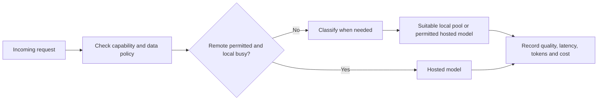

# Enterprise user counts, Revolut and adaptive hybrid routing

Analysis requested 2026-11-12. The author observes no feasible result at 1050 users
under every preset. This investigation reproduces that boundary with saved scenarios,
examines the two supplied posts and identifies the additional evidence needed.
No production code/data, user defaults, coefficients or capacity policy changed.

## The 1050-user result is reproduced

Both frontend validation and the domain permit **1 to 100000 active users**:
`frontend/src/lib/scenario.ts:validUsers` and `domain/scenario.py:WorkloadProfile`.
There is no 1000-user input bound. Presets choose ranking weights after hard
filtering, so they cannot restore a deployment rejected by capacity or budget.

New offline service evaluations use the current catalog and engine 0.1.4. They are
not inference benchmarks or repeated acceptance tests. Complete inputs, engine
parameters, catalog fingerprint, rejection histograms and representative candidates
are saved in [user_scale_diagnostic.json](evidence/enterprise_routing_analysis_2026-11-12/user_scale_diagnostic.json).
The author's live scenario export was not available; the enterprise defaults and
saved self-managed baseline produce the same admission counts at these user counts:

| Active users | Admitted candidates | Result under either saved profile |
|---:|---:|---|
| 1000 | 1 | RTX PRO 6000 96 GB x4, Flash-Next INT2 |
| 1001 | 1 | Same deployment |
| 1050 | 0 | Its monthly utilization exceeds 1 |
| 2000 | 0 | Current search/budget/evidence combination admits none |

The last admitted deployment has USD 71456 modeled CapEx, under the default USD
100000 purchase budget. Its formula aggregate rate is 5263.0466 TPS, giving
3334666301.7 modeled output tokens in 176 active hours/month. The workload is:

`users x 40 requests/day x 22 days/month x (1500 output x 2.5 thinking multiplier)`

That is **3300000 output tokens per user/month**, or 3.300 billion at 1000 users.
The resulting modeled capacity is **1010.5049 users** at that workload. At 1050,
demand is 3.465 billion and utilization is **1.03908448**, approximately 3.9% above
the assumed capacity. This is the `users_served` rejection, not input validation.

These are model outputs, not a measured 1010-user service limit. Aggregate TPS
comes from the existing saturating-batch fallback, using up to 83 modeled resident
slots for this candidate. It is not throughput measured at the scenario's five
peak requests, and the app has no validated queueing/arrival-time SLA model.
The separate simultaneous-capacity rule remains settled and unchanged. INT2 tool
quality also remains unresolved; admitting a candidate is not empirical validation.

An explicit counterfactual removes only the CapEx cap, preserving other assumptions:
1050 users then admits 13 candidates and 2000 admits 10. Its Best Fit winner is a
per-seat M5 Ultra option, costing USD 11.136M / 21.211M modeled CapEx respectively.
Those totals buy 1050 / 2000 separate workstations; `nodes=1` is per workstation,
not one shared Mac for the company. This is a diagnostic, not a purchase proposal
or verified quotation. Saved in [budget_counterfactual.json](evidence/enterprise_routing_analysis_2026-11-12/budget_counterfactual.json).

The diagnosis is therefore constrained candidate coverage plus modeled demand,
budget and evidence. It does not establish that organizations above 1000 users
cannot deploy AI. Missing API timing currently rejects all four pure API options;
that means evidence is unavailable, not that they were measured too slow.

## What Revolut actually demonstrates

The [primary conference account](https://ai.engineer/nyc/2026/talks/revolut) reports
about **2000 engineers** served by **56 B200 GPUs** running GLM 5.3, following 5.1.
This is employee coding infrastructure, not one simultaneous model request per
bank customer. It describes tuning context, FP4, tensor parallelism and cache use,
and discusses speculation and prefill/decode separation. Reported TTFT fell to
approximately 1.6 seconds while request rate exceeded seven per second on the same
fleet. Commercial models remained exceptions. These are company-reported results.

The [LinkedIn rental estimate](https://www.linkedin.com/posts/andevo_revolut-rents-56-nvidia-b200-gpus-164k-share-7524084235712925696-YJ6v/)
remains unsupported by an actual quote. Reuse [the existing case study](REVOLUT_CASE_STUDY.md)
for the economic caveats and historical claims; no need to repeat its investigation
or treat its rates as calibration inputs.

The transferable design lesson is **shared serving capacity matched to arrivals and
task mix**, not GPUs per employee. Total seats, retained sessions, arrival rate,
simultaneous inference and model-parallel GPU count are separate quantities.
The precise peak-concurrency distribution and latency percentiles for that fleet
are not established by the cited account.

The DSS does not currently enumerate an equivalent enterprise service. Its purchased
candidate grid intersects hardware node counts with `{1,2,4,8}` and has no independent
replica count. Rentals are fixed catalog packages, not automatically repeated fleets.
There is no B200 catalog entry, explicit replica placement, load balancing,
prefill/decode fleet allocation, failover headroom or autoscaling scheduler.
Increasing a tensor-parallel node count and adding complete service replicas are
different deployment choices. Adding a 512 GB Mac entry alone would not resolve this.

## What Julien's Pi setup contributes

[Julien's post](https://www.linkedin.com/posts/julienchaumond_one-of-the-coolest-recent-features-in-pi-share-7525932966305267712-mb0k/)
describes local Qwen 3.8 27B versus hosted Kimi K3/GLM 5.3, routed by query difficulty
and machine load. When congested it bypasses the local classifier and goes remote.
The exact extension, thresholds, routing distribution and measured improvement are
not published in the supplied post.

[Pi's primary documentation](https://pi.dev/docs/latest/virtual-models) confirms
per-request virtual-model dispatch. It explicitly notes classifier latency and
prompt-cache loss when changing models, and illustrates keeping continuations and
retries on their prior model. Archived repository documentation is pinned to
`841dc6050b5f0014733ee40436f8ad7cf80c93fe`.

The following is a proposed evaluation architecture, not an implemented DSS feature:

For a private task that cannot leave the local deployment, congestion must lead to
an allowed local queue/rejection/alternative, not automatic cloud fallback. This is
a constraint of the user's chosen data policy, not a new compliance gate.

The current DSS Hybrid Split uses a fixed local demand ratio, full fixed local
ownership cost and a proportional API cost. It retains the full requested local
peak under the author's settled policy. It does not implement a classifier, load
threshold, request scheduler, escalation/retry path or session affinity. A static
70% local assumption is not a measured adaptive policy. Its local share is applied
to homogeneous workload demand; 70% of requests need not equal 70% of tokens or GPU
time when the remote tasks are the hardest/longest ones.

For this project, an adaptive comparison should count:

- Classifier inference/latency, including bypass behavior at congestion.
- Local and remote token demand by task class, arrival burst and retained state.
- Cache misses and transferred conversation/prefix tokens after a switch.
- Retries, escalations, failed tasks, quality loss and API rate limits.
- Per-component capacity/SLA and full fixed costs, plus only the applicable routed
  usage charges. Report cost per successful task alongside token-based TCO.

This is a promising enterprise extension, but no measured savings or maximum user
count follows from the post alone. Do not assume that complexity classification is
accurate or that a weighted average quality score proves routed task success.

## Focused evidence request for an external search agent

Search primary operator material and linked original logs, not new summaries of
sources already archived. Return exact source URLs, timestamps, permanent run IDs,
artifact/build settings, raw files and explicitly missing fields.

1. **An enterprise shared-serving load test:** model/quantization and serving build;
   GPUs per replica and number of replicas; input/output/context/cache distributions;
   arrival RPS and actual simultaneous requests; aggregate output rate and per-request
   p50/p95/p99 TTFT, generation rate and total latency; failures and memory use.
   For the Revolut claim specifically, seek the fleet layout, sustained/peak load,
   exact serving configuration and a real infrastructure quote/cost boundary.
2. **Julien's exact Pi extension and an evaluated routing trace:** repo/commit,
   classifier prompt/API and thresholds; the load signal and congestion-bypass rule;
   session affinity; local/remote request and token fractions; cache misses,
   escalations/retries, task success, TTFT percentiles and cost against local-only
   and hosted-only baselines on the same tasks. The post itself gives no such run.
3. **The remaining Mac workload:** M5 Ultra 512 GB (and separately M5 Max 128 GB)
   with five simultaneous requests each occupying about 131072 input tokens,
   preferably 512 actual generated tokens per request; exact artifacts/KV/cache/
   MTP settings; each request's latency/rate plus aggregate throughput and memory.
   Also seek eight retained sessions and exact 2/3-bit tool-quality evaluations.
   Reuse the acquired 512 GB Q6/GPT/DeepSeek records rather than fetching them again.
4. **Comparable API request logs:** exact endpoint/model/region, prompt and output
   counts, cache state, concurrency and retries; client TTFT/last-token times and
   task success. Prices alone do not resolve the current API evidence exclusion.

When a field is unavailable, report that precisely. There is no benchmark machine
available here; do not promise controlled measurements, schedule paid inference or
invent fleet topology, concurrency, 512 GB speed, quality or rental prices.

## Saved work and scope

Six new primary responses, URLs/retrieval times/bytes/SHA-256 and the pinned Pi
source are in [manifest.json](evidence/enterprise_routing_analysis_2026-11-12/manifest.json).
The [offline derivation](evidence/enterprise_routing_analysis_2026-11-12/derive_user_scale.py)
reproduces eight new user-count scenarios. Two separate budget counterfactuals save
their complete inputs and outputs. No previous sensitivity outputs were overwritten.
U-07 now has concrete enterprise fleet/adaptive-routing design gaps; implementation
and empirical validation remain future work, not a completed task. No commit/push.

Verification: six acquired source hashes/sizes, ten saved scenario records, capacity
arithmetic, budget-only counterfactual differences and local report links pass.
All 33 changed-document continuity checks pass. No application, frontend or browser
suite was repeated. No paid API calls, model downloads or inference were performed.
